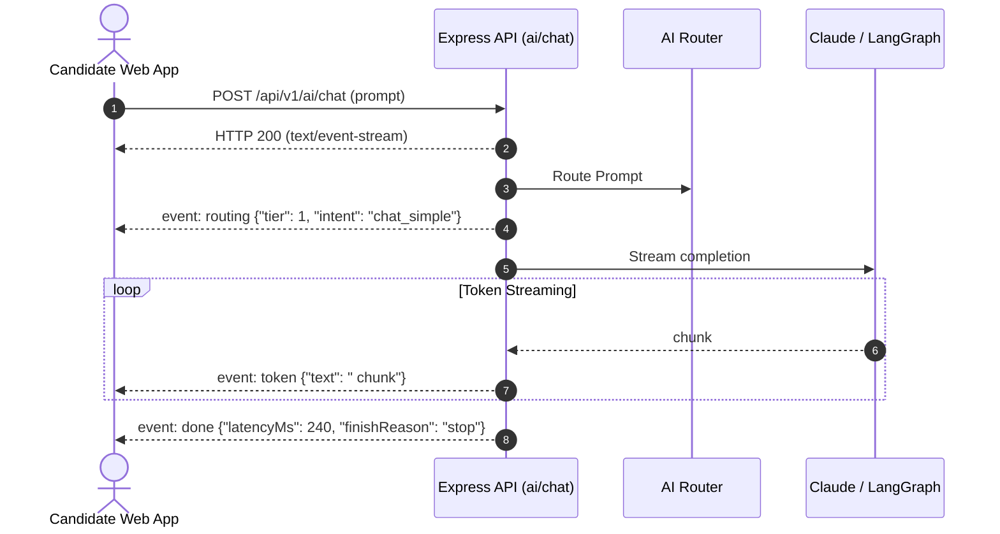

# JobScout API Specification & Integration Reference

## 1. Network & Protocol Standards

### 1.1. Base URLs

| Environment           | Base URL                          | Description                              |
| --------------------- | --------------------------------- | ---------------------------------------- |
| **Local Development** | `http://localhost:4001`           | Local Express monolith                   |
| **Staging**           | `https://staging-api.jobscout.ai` | Staging cluster (Vercel / Fly / Railway) |
| **Production**        | `https://api.jobscout.ai`         | Global distributed API Gateway           |

### 1.2. Global Request Headers

| Header             | Type     | Description                                                                           | Required When                                                                                      |
| ------------------ | -------- | ------------------------------------------------------------------------------------- | -------------------------------------------------------------------------------------------------- |
| `Authorization`    | `string` | Bearer token format: `Bearer <jwt_access_token>`.                                     | All authenticated requests (unless using `accessToken` httpOnly cookie).                           |
| `Content-Type`     | `string` | `application/json` or `multipart/form-data`.                                          | All POST, PUT, PATCH requests with a body.                                                         |
| `X-Request-Id`     | `string` | Client-generated trace UUID or nanoid. Echoed in response headers and logger entries. | Recommended on every call for end-to-end distributed tracing.                                      |
| `X-Requested-With` | `string` | CSRF defense header (`JobScoutClient` or `XMLHttpRequest`).                           | Mandatory on state-changing requests (`POST`, `PUT`, `PATCH`, `DELETE`) authenticated via cookies. |
| `Idempotency-Key`  | `string` | UUID guaranteeing exactly-once execution within a 24-hour window.                     | Recommended on payments, document approval, and email dispatches.                                  |

### 1.3. Standard Response Envelope

All API endpoints return a standardized JSON envelope with consistent key structures.

#### Success Envelope (`200 OK` / `201 Created`)

```json
{
  "data": {
    "key": "value"
  }
}
```

#### Error Envelope (`4xx` / `5xx`)

```json
{
  "error": {
    "code": "VALIDATION_ERROR",
    "message": "Invalid request parameters provided.",
    "details": [
      {
        "field": "email",
        "message": "Must be a valid email address format."
      }
    ],
    "requestId": "req_8xL2k9Pz1a"
  }
}
```

### 1.4. Standard Error Codes Matrix

| HTTP Status | Error Code              | Description / Resolution                                                        |
| ----------- | ----------------------- | ------------------------------------------------------------------------------- |
| `400`       | `VALIDATION_ERROR`      | Request failed Zod schema parsing. Review `details` array.                      |
| `400`       | `INVALID_FILE_TYPE`     | Uploaded resume failed magic bytes inspection (not a real PDF/DOCX).            |
| `400`       | `NO_PROFILE_FACTS`      | Candidate profile lacks parsed facts. Upload a resume first.                    |
| `401`       | `UNAUTHORIZED`          | Bearer token or session cookie missing or expired.                              |
| `401`       | `INVALID_TOKEN`         | Access token signature verification failed.                                     |
| `401`       | `TOKEN_REUSE_DETECTED`  | Rotated refresh token replayed; token family revoked. Re-authenticate.          |
| `403`       | `FORBIDDEN`             | Authenticated candidate lacks access to target resource.                        |
| `403`       | `PLAN_UPGRADE_REQUIRED` | Feature (e.g., Interview Prep, Mock Interview) requires Pro or Premium tier.    |
| `404`       | `NOT_FOUND`             | Target entity (application, document, job) does not exist or was soft-deleted.  |
| `429`       | `QUOTA_EXCEEDED`        | Candidate reached daily or monthly plan limit for feature.                      |
| `429`       | `DAILY_BUDGET_EXCEEDED` | Candidate reached daily AI cost limit ($0.10 Free / $1.50 Pro / $5.00 Premium). |
| `429`       | `ACCOUNT_LOCKED`        | Account locked for 15 minutes after 5 consecutive failed login attempts.        |
| `503`       | `AI_KILL_SWITCH_ACTIVE` | Operational emergency switch enabled; heavy LLM workflows paused.               |
| `503`       | `SERVICE_UNAVAILABLE`   | External dependency (MongoDB, Redis, Anthropic) degraded.                       |

---

## 2. Server-Sent Events (SSE) Protocol

The streaming AI endpoint (`POST /api/v1/ai/chat`) utilizes the W3C Server-Sent Events standard over HTTP/1.1 or HTTP/2.

### Protocol Specification

- **Content-Type**: `text/event-stream; charset=utf-8`
- **Cache-Control**: `no-cache, no-transform`
- **Connection**: `keep-alive`

### Stream Event Types



1. **`event: routing`**: Emitted immediately upon AI Router classification.
   ```
   event: routing
   data: {"tier":1,"intent":"chat_simple","confidence":0.95,"latencyMs":18}
   ```
2. **`event: progress`**: Emitted during multi-step graph workflows (e.g. Discovery, Tailoring).
   ```
   event: progress
   data: {"step":"truthfulness_check","status":"validating_fact_ids","percentage":60}
   ```
3. **`event: token`**: Incremental text chunk streamed as generated by the model.
   ```
   event: token
   data: {"text":"Based on your experience with distributed queues..."}
   ```
4. **`event: done`**: Terminal event indicating stream finalization.
   ```
   event: done
   data: {"finishReason":"stop","tokensUsed":215,"totalDurationMs":485}
   ```

---

## 3. Complete Endpoint Reference

### 3.1. Health & Operations

#### `GET /health/live`

- **Purpose**: Kubernetes and load-balancer liveness check.
- **Auth**: None.
- **Response `200 OK`**:
  ```json
  {
    "status": "ok",
    "timestamp": "2026-10-15T01:00:00.000Z",
    "uptime": 1420
  }
  ```

#### `GET /health/ready`

- **Purpose**: Readiness probe validating database and cache availability.
- **Auth**: None.
- **Response `200 OK`** (Healthy):
  ```json
  {
    "status": "ready",
    "dependencies": {
      "mongodb": "connected",
      "redis": "connected"
    }
  }
  ```
- **Response `503 Service Unavailable`** (Degraded):
  ```json
  {
    "status": "degraded",
    "dependencies": {
      "mongodb": "disconnected",
      "redis": "connected"
    }
  }
  ```

---

### 3.2. Authentication & Session Management (`/api/v1/auth`)

#### `POST /api/v1/auth/register`

- **Purpose**: Registers a new candidate account.
- **Headers**: `Content-Type: application/json`, `X-Requested-With: JobScoutClient`
- **Request Body**:
  ```json
  {
    "email": "candidate@example.com",
    "password": "Password123!",
    "name": "Jane Doe"
  }
  ```
- **Response `201 Created`**:
  ```json
  {
    "data": {
      "user": {
        "id": "670ecb18f32df62fd2876160",
        "email": "candidate@example.com",
        "name": "Jane Doe",
        "role": "user",
        "plan": "free"
      },
      "accessToken": "eyJhbGciOiJIUzI1NiIsInR5cCI6IkpXVCJ9..."
    }
  }
  ```
- **Set-Cookie Header**: `refreshToken=<token>; HttpOnly; Secure; SameSite=Lax; Path=/api/v1/auth; Max-Age=604800`

#### `POST /api/v1/auth/login`

- **Purpose**: Authenticates candidate with email and password.
- **Request Body**:
  ```json
  {
    "email": "candidate@example.com",
    "password": "Password123!"
  }
  ```
- **Response `200 OK`**: Same shape as register.
- **Error `429 Too Many Requests`**:
  ```json
  {
    "error": {
      "code": "ACCOUNT_LOCKED",
      "message": "Account temporarily locked due to repeated failed logins. Try again in 15 minutes.",
      "requestId": "req_01"
    }
  }
  ```

#### `POST /api/v1/auth/google`

- **Purpose**: Authenticates candidate via Google Identity Services OAuth ID token.
- **Request Body**:
  ```json
  {
    "idToken": "eyJhbGciOiJSUzI1NiIsImtpZCI6IjEy..."
  }
  ```
- **Response `200 OK`**: Returns session and JWT tokens.

#### `POST /api/v1/auth/refresh`

- **Purpose**: Rotates refresh token and issues a fresh 15-minute access token.
- **Headers**: `X-Requested-With: JobScoutClient`
- **Request Body** (optional if cookie sent):
  ```json
  {
    "refreshToken": "eyJhbGciOiJIUzI1NiIsInR5cCI6IkpXVCJ9..."
  }
  ```
- **Response `200 OK`**:
  ```json
  {
    "data": {
      "accessToken": "eyJhbGciOiJIUzI1NiIsInR5cCI6IkpXVCJ9..."
    }
  }
  ```
- **Error `401 Unauthorized`** (Reuse Detection Triggered):
  ```json
  {
    "error": {
      "code": "TOKEN_REUSE_DETECTED",
      "message": "Refresh token reuse detected. Please log in again.",
      "requestId": "req_02"
    }
  }
  ```

#### `GET /api/v1/auth/me`

- **Purpose**: Fetches authenticated candidate profile and current subscription status.
- **Auth**: Bearer token or cookie.
- **Response `200 OK`**:
  ```json
  {
    "data": {
      "user": {
        "id": "670ecb18f32df62fd2876160",
        "email": "candidate@example.com",
        "name": "Jane Doe",
        "role": "user",
        "plan": "pro",
        "planVersion": 1,
        "profileVersion": 2,
        "memoryPaused": false
      }
    }
  }
  ```

#### `POST /api/v1/auth/logout`

- **Purpose**: Clears cookies and revokes active token family.
- **Response `200 OK`**: `{"data": {"message": "Logged out successfully"}}`

---

### 3.3. Candidate Profile & Resume Parsing (`/api/v1/profile`)

#### `POST /api/v1/profile/resume-upload-url`

- **Purpose**: Creates a five-minute, user-scoped AWS S3 `PUT` URL for direct browser upload.
- **Headers**: Bearer authentication and `X-Requested-With: JobScoutClient` (or the authenticated session cookie plus CSRF headers).
- **JSON body**: `{ "originalFilename": "resume.pdf", "mimeType": "application/pdf", "fileSize": 12345 }`. DOCX uses its standard OpenXML MIME type. Files must be non-empty and at most 5 MB.
- **Response**: `{ "data": { "uploadId": "<uuid>", "uploadUrl": "<presigned-url>", "requiredHeaders": { "Content-Type": "application/pdf" }, "expiresInSeconds": 300 } }`.
- **Browser upload**: `PUT` the file bytes to `uploadUrl` with every `requiredHeaders` value. The S3 bucket CORS policy must allow the frontend origin, `PUT`, and the `Content-Type` request header.

#### `POST /api/v1/profile/resume-upload-complete`

- **Purpose**: Verifies the authenticated user's uploaded object in S3, checks its size/content type and file magic, then extracts and stores resume facts. Completion is safe to retry for the same `uploadId`.
- **JSON body**: `{ "uploadId": "<uuid>", "originalFilename": "resume.pdf", "mimeType": "application/pdf" }`.
- **Storage**: The API constructs the object key from the authenticated user and UUID; clients cannot choose another user's key. Original bytes are downloaded only after the S3 metadata and size checks.
- **Response**: Includes the updated profile, `factsSummary` counts, and `resume` metadata (`id`, filename, MIME type, upload time, fact counts, and `status`). Retrying a completed upload returns the same resume metadata without reprocessing or creating another record.

The existing multipart endpoint below remains available for compatibility and local mock mode.

#### `POST /api/v1/profile/upload-resume`

- **Purpose**: Uploads and parses resume into immutable structured facts with unique `factId`s.
- **Headers**: `Content-Type: multipart/form-data`, `X-Requested-With: JobScoutClient`
- **Form Data**:
  - `file`: Binary document buffer (PDF or DOCX, max 5MB).
- **Security Check**: Magic bytes (`%PDF-` for PDF, `PK\x03\x04` for DOCX) verified against spoofed extensions.
- **Extraction**: Uses the configured backend LLM provider; extracted fields are checked against source text. It does not invent a sample profile when no provider key is configured.
- **Storage**: Extracted text is encrypted with AES-256-GCM in the database. The original file is stored in configured S3/R2 storage; dummy credentials only enable non-persistent local mock mode. Production fails if file storage is unavailable.
- **Errors**: `INSUFFICIENT_TEXT` for scanned/image-only files, `AI_PROVIDER_NOT_CONFIGURED` when no selected LLM key is set, and `FACTS_NOT_EXTRACTED` when no verifiable facts are found.
- **Response `200 OK`**:
  ```json
  {
    "data": {
      "message": "Resume successfully parsed and encrypted",
      "profile": {
        "roles": [
          {
            "factId": "role_N82bXk1a",
            "title": "Principal Engineer",
            "company": "Tech Systems Inc",
            "startDate": "2021-01",
            "endDate": "Present",
            "isCurrent": true,
            "achievements": [
              {
                "factId": "ach_m91XkpA2",
                "bullet": "Architected distributed microservices handling 25,000 rps.",
                "metrics": "25k rps, 99.99% uptime"
              }
            ]
          }
        ],
        "skills": [
          { "factId": "skl_11mNa90p", "name": "Node.js", "category": "backend" },
          { "factId": "skl_44pQz81x", "name": "Kubernetes", "category": "cloud" }
        ],
        "education": [
          {
            "factId": "edu_55bNq22z",
            "degree": "B.S. in Computer Science",
            "institution": "State University"
          }
        ]
      },
      "factsSummary": {
        "roles": 1,
        "skills": 2,
        "education": 1,
        "totalFacts": 4
      }
    }
  }
  ```

#### `GET /api/v1/profile/facts`

- **Purpose**: Returns flattened list of all candidate facts used for truthfulness verification. Every fact includes `factId`, `type`, and a display-ready `label`; type-specific fields are included when available. If the user has not uploaded a resume, the endpoint returns an empty collection.
- **Response `200 OK`** (all fact types):

  ```json
  {
    "data": {
      "totalFacts": 4,
      "facts": [
        {
          "factId": "role_N82bXk1a",
          "type": "role",
          "label": "Principal Engineer at Tech Systems Inc"
        },
        {
          "factId": "ach_m91XkpA2",
          "type": "achievement",
          "label": "Architected distributed microservices handling 25,000 rps.",
          "bullet": "Architected distributed microservices handling 25,000 rps.",
          "metrics": "25,000 rps"
        },
        {
          "factId": "skl_7b1kPq2m",
          "type": "skill",
          "label": "TypeScript",
          "name": "TypeScript",
          "category": "programming"
        },
        {
          "factId": "edu_4v9nLx3c",
          "type": "education",
          "label": "B.S. Computer Science at State University",
          "degree": "B.S. Computer Science",
          "institution": "State University"
        }
      ]
    }
  }
  ```

- **Empty response before resume upload**: `{ "data": { "totalFacts": 0, "facts": [] } }`.

#### `PUT /api/v1/profile/preferences`

- **Purpose**: Updates job search preferences and increments `profileVersion` for cache invalidation.
- **Request Body**:
  ```json
  {
    "targetRoles": ["Staff Engineer", "Backend Architect"],
    "minimumSalaryUsd": 160000,
    "preferredLocations": ["Remote", "San Francisco"],
    "remotePreference": "remote"
  }
  ```
- **Response `200 OK`**: Returns updated profile object with bumped version.

---

### 3.4. AI Router & Streaming Chat (`/api/v1/ai`)

#### `POST /api/v1/ai/route`

- **Purpose**: Runs prompt through the 3-tier router to return execution metadata.
- **Request Body**:
  ```json
  {
    "prompt": "Show my applications this week"
  }
  ```
- **Response `200 OK`** (Tier 0 Deterministic Hit):
  ```json
  {
    "data": {
      "tier": 0,
      "hitType": "deterministic_query",
      "intent": "db_lookup",
      "latencyMs": 1.2,
      "costUsd": 0.0
    }
  }
  ```

#### `POST /api/v1/ai/chat` (SSE Streaming)

- **Purpose**: Primary conversational agent interface supporting real-time streaming.
- **Headers**: `Accept: text/event-stream`, `X-Requested-With: JobScoutClient`
- **Request Body**:
  ```json
  {
    "prompt": "How can I improve my resume for distributed backend roles?",
    "threadId": "th_session_001",
    "modelId": "gemini-3.1-flash-lite"
  }
  ```
- `modelId` is required and must be in the server's free-tier chat allowlist; missing, paid, and unknown models are rejected. An explicit selection skips the model-powered classifier and is used directly for that turn.
- **Stream Output**: Emits `event: routing`, `event: token`, `event: done`.

#### `GET /api/v1/ai/models`

Returns the authenticated user's currently selectable chat models. The list is controlled by the backend and only includes configured, enabled models. Never trust a client-supplied provider/model pair.

---

### 3.5. Candidate Memory Management (`/api/v1/memories`)

#### `GET /api/v1/memories`

- **Purpose**: Lists all active long-term memories extracted by the agent.
- **Response `200 OK`**:
  ```json
  {
    "data": {
      "memories": [
        {
          "id": "670ecb18f32df62fd2876199",
          "type": "preference",
          "key": "dislikes_agencies",
          "content": "Candidate strongly dislikes third-party recruitment agencies.",
          "importance": 4,
          "confidence": 0.95
        }
      ]
    }
  }
  ```

#### `POST /api/v1/memories/toggle-pause`

- **Purpose**: Temporarily pauses or resumes agent memory writes.
- **Response `200 OK`**:
  ```json
  {
    "data": {
      "message": "Memory writing paused",
      "memoryPaused": true
    }
  }
  ```

#### `POST /api/v1/memories/forget-all`

- **Purpose**: Soft-deletes all long-term vector memories for the candidate.
- **Response `200 OK`**: `{"data": {"message": "All memories cleared successfully"}}`

---

### 3.6. Job Discovery & Matches (`/api/v1/jobs`)

#### `GET /api/v1/jobs/matches`

- **Purpose**: Retrieves top job opportunities ranked by vector cosine similarity and rule filters.
- **Caching**: L1 Redis response cache (60 seconds TTL).
- **Response `200 OK`**:
  ```json
  {
    "data": {
      "totalMatches": 10,
      "fromCache": false,
      "matches": [
        {
          "jobId": "job_c5c37c0a87",
          "title": "Staff Backend Engineer",
          "company": "Acme",
          "location": "Remote",
          "score": 92.5,
          "rationale": "Strong alignment with candidate's distributed systems and caching background.",
          "matchingSkills": ["Node.js", "Redis", "Distributed Systems"],
          "missingSkills": ["GraphQL"]
        }
      ]
    }
  }
  ```

#### `POST /api/v1/jobs/discover`

- **Purpose**: Manually triggers Graph A discovery cycle. Gated by `match_jobs` quota.
- **Response `200 OK`**: Returns new matches generated.

#### `GET /api/v1/jobs/catalog`

- **Purpose**: Searches all non-expired jobs currently indexed by enabled adapters (not the whole public internet).
- **Query**: Optional `q`, `location`, `source`, `remoteType` (`remote|hybrid|onsite`), `page` (default 1), `limit` (default 20, max 50).
- **Response**: `{ "data": { "jobs": [], "total": 0, "page": 1, "limit": 20, "pages": 0 } }`. Each result includes `jobId`, role/company, source board, and original listing URL where available.

#### `POST /api/v1/jobs/:id/feedback`

- **Purpose**: Records candidate feedback (`thumbs_up` or `thumbs_down`) and trains preferences.
- **Request Body**:
  ```json
  {
    "feedback": "thumbs_down",
    "reason": "Compensation range is below minimum salary requirement."
  }
  ```
- **Response `200 OK`**: Confirms feedback recorded and preference memory persisted.

---

### 3.7. Resume Tailoring Graph B (`/api/v1/tailor`)

#### `POST /api/v1/tailor/start`

- **Purpose**: Initiates Graph B tailoring. Analyzes JD, maps candidate `factId`s, runs `truthfulnessCheck`, and pauses for candidate approval.
- **Quota Gate**: Requires 1 `tailor_resume` credit.
- **Request Body**:
  ```json
  {
    "jobId": "job_c5c37c0a87",
    "jobTitle": "Staff Backend Engineer",
    "company": "Acme",
    "jdText": "Looking for a Staff Engineer experienced in high-throughput API architecture."
  }
  ```
- **Response `201 Created`**:
  ```json
  {
    "data": {
      "documentId": "doc_1_1792007085373",
      "status": "awaiting_approval",
      "jobTitle": "Staff Backend Engineer",
      "company": "Acme",
      "bullets": [
        {
          "factId": "ach_m91XkpA2",
          "originalBullet": "Architected distributed microservices handling 25,000 rps.",
          "tailoredBullet": "Architected event-driven microservices handling 25,000 rps with 99.99% uptime, aligning directly with Acme's high-throughput API reliability goals.",
          "isVerified": true
        }
      ],
      "atsMatch": {
        "score": 88,
        "covered": ["node.js", "redis", "api"],
        "missing": ["kafka"]
      },
      "message": "Draft created. Review bullets and approve or reject."
    }
  }
  ```

#### `POST /api/v1/tailor/:id/approve`

- **Purpose**: Human approval to compile tailored resume into ATS-friendly PDF and DOCX.
- **Request Body** (optional bullet edits):
  ```json
  {
    "editedBullets": []
  }
  ```
- **Response `200 OK`**:
  ```json
  {
    "data": {
      "documentId": "doc_1_1792007085373",
      "status": "approved",
      "pdfUrl": "https://s3.amazonaws.com/jobscout/exports/doc_1/tailored_resume.pdf",
      "docxUrl": "https://s3.amazonaws.com/jobscout/exports/doc_1/tailored_resume.docx",
      "approvedAt": "2026-10-15T01:10:00.000Z"
    }
  }
  ```

#### `GET /api/v1/tailor/:id/export?format=pdf|docx`

- **Purpose**: Downloads compiled ATS-friendly binary file stream.
- **Response**: Binary stream (`application/pdf` or `application/vnd.openxmlformats...`).

---

### 3.8. Application Tracker & Follow-Up Automation (`/api/v1/applications`)

#### `GET /api/v1/applications`

- **Purpose**: Retrieves candidate Kanban board columns (`saved`, `applied`, `screening`, `interviewing`, `offer`, `rejected`).
- **Response `200 OK`**:
  ```json
  {
    "data": {
      "total": 3,
      "columns": {
        "saved": [],
        "applied": [
          {
            "_id": "app_1_1792007301865",
            "company": "Acme",
            "role": "Staff Infrastructure Engineer",
            "status": "applied",
            "nextFollowUpAt": "2026-10-20T01:00:00.000Z",
            "followUpDraft": {
              "subject": "Following up on application for Staff Infrastructure Engineer - Jane Doe",
              "status": "draft"
            }
          }
        ],
        "screening": [],
        "interviewing": [],
        "offer": [],
        "rejected": []
      }
    }
  }
  ```

#### `POST /api/v1/applications`

- **Purpose**: Adds an application to the Kanban board.
- **Request**: `jobId` is optional for a manually entered role; when omitted the API assigns a unique local identifier. Job-card submissions should pass the catalog or match `jobId`.
- **Request Body**:
  ```json
  {
    "jobId": "job_c5c37c0a87",
    "company": "Acme",
    "role": "Staff Infrastructure Engineer",
    "status": "saved",
    "notes": "Referred by engineering director.",
    "jobUrl": "https://jobs.example.com/role",
    "hrPhone": "+1 555 0100",
    "companyEmail": "recruiting@example.com",
    "nextFollowUpAt": "2026-10-20T15:00:00.000Z",
    "reminderEnabled": true
  }
  ```

#### `PATCH /api/v1/applications/:id`

- **Purpose**: Update notes, job link, recruiter phone, company email, and follow-up reminder settings. The reminder email is sent to the signed-in candidate, not the company contact. Scheduling requires Redis and the background worker; the application is saved with `reminderStatus: "failed"` if scheduling is unavailable.
- **Reminder status**: `none`, `scheduled`, `processing`, `sent`, `mock`, or `failed`.

#### `PATCH /api/v1/applications/:id/status`

- **Purpose**: Moves pipeline stage. Moving to `applied` or `interviewing` triggers Graph D to draft a follow-up email.
- **Request Body**:
  ```json
  {
    "status": "applied",
    "note": "Submitted application online."
  }
  ```

#### `POST /api/v1/applications/:id/follow-up/approve`

- **Purpose**: Human-in-the-loop approval to dispatch drafted follow-up email via Resend.
- **Response `200 OK`**: `{"data": {"message": "Follow-up email approved and dispatched successfully"}}`

---

### 3.9. Interview Prep & Mock Interview (`/api/v1/interview`)

#### `POST /api/v1/interview/prep`

- **Purpose**: Generates company research brief, role question bank, and STAR stories.
- **Plan Gate**: Requires Pro or Premium tier.
- **Request Body**:
  ```json
  {
    "jobTitle": "Staff Infrastructure Engineer",
    "company": "Acme",
    "jdText": "Design and operate distributed storage infrastructure."
  }
  ```
- **Response `200 OK`**:
  ```json
  {
    "data": {
      "companyOverview": "Acme is an industry-leading technology enterprise...",
      "cultureInsights": ["Emphasis on distributed systems architecture and system resilience."],
      "questions": [
        {
          "id": "q_01",
          "category": "technical",
          "question": "How do you approach cache stampede prevention in high-throughput APIs?",
          "context": "Assesses distributed locking and database protection.",
          "recommendedApproach": "Discuss single-flight mutex locks and probabilistic early expiration."
        }
      ],
      "suggestedStarStories": [
        {
          "factId": "ach_m91XkpA2",
          "situation": "High-traffic spikes caused connection exhaustion.",
          "task": "Eliminate downtime without exploding cloud costs.",
          "action": "Implemented single-flight distributed locking.",
          "result": "Reduced database load by 65% with zero outages."
        }
      ]
    }
  }
  ```

#### `POST /api/v1/interview/mock/turn`

- **Purpose**: Evaluates candidate response using the STAR framework. Hard-capped at 5 turns.
- **Plan Gate**: Requires Premium tier.
- **Request Body**:
  ```json
  {
    "sessionId": "session_670ecb18_179200",
    "questionId": "q_01",
    "question": "Describe a complex distributed system failure you diagnosed and resolved.",
    "candidateAnswer": "During peak load, our Redis connection pool became exhausted..."
  }
  ```
- **Response `200 OK`**:
  ```json
  {
    "data": {
      "sessionId": "session_670ecb18_179200",
      "turnNumber": 1,
      "maxTurns": 5,
      "isComplete": false,
      "score": 88,
      "starScores": { "situation": 22, "task": 21, "action": 23, "result": 22 },
      "strengths": ["Clear explanation of technical tradeoffs."],
      "improvements": ["Mention cross-functional collaboration with DevOps."],
      "feedback": "Strong answer following the STAR methodology effectively.",
      "nextQuestion": "Tell me about a time you made a decision with incomplete information."
    }
  }
  ```

#### `GET /api/v1/interview/:id/report`

- **Purpose**: Generates aggregate performance scorecard and readiness assessment.
- **Response `200 OK`**:
  ```json
  {
    "data": {
      "sessionId": "session_670ecb18_179200",
      "totalTurnsCompleted": 1,
      "averageScore": 88,
      "readinessAssessment": "Interview Ready — High confidence for senior/staff roles."
    }
  }
  ```

---

### 3.10. Billing & Subscriptions (`/api/v1/billing`)

#### `POST /api/v1/billing/checkout`

- **Purpose**: Creates a Razorpay subscription checkout link. Configure `RAZORPAY_PLAN_ID_PRO` and `RAZORPAY_PLAN_ID_PREMIUM` in the backend.
- **Request Body**:
  ```json
  {
    "plan": "pro",
    "provider": "razorpay"
  }
  ```
- **Response `200 OK`**:
  ```json
  {
    "data": {
      "checkoutUrl": "https://rzp.io/...",
      "sessionId": "sub_...",
      "provider": "razorpay"
    }
  }
  ```

#### `POST /api/v1/billing/razorpay-webhook`

- **Purpose**: Signature-verified webhook receiver for Razorpay India events.
- **Headers**: `X-Razorpay-Signature: 2fe47...`
- **Handling**: HMAC-SHA256 verified using `RAZORPAY_WEBHOOK_SECRET`.

---

### 3.11. Admin & Telemetry (`/api/v1/admin`)

#### `GET /api/v1/admin/metrics`

- **Purpose**: Real-time operational dashboard for administrators.
- **Role Requirement**: `admin` or `super_admin` role required (HTTP 403 otherwise).
- **Note**: The following payload is illustrative. The API returns live values; Mongo-dependent totals are `null` in fallback mode and queue metrics use `not_configured` until workers report real values.
- **Response `200 OK`**:
  ```json
  {
    "data": {
      "uptimeSeconds": 3480,
      "status": "degraded",
      "totals": { "users": null, "jobs": null },
      "dependencies": {
        "mongo": "connected",
        "redis": "connected"
      },
      "cache": {
        "hits": 142,
        "misses": 18,
        "hitRate": 88.8
      },
      "aiRouter": {
        "tier0": 48,
        "tier1": 24,
        "tier2": 6,
        "tier0Percentage": 61.5,
        "tier1Percentage": 30.8,
        "tier2Percentage": 7.7,
        "meetsTarget": true
      },
      "costTelemetry": {
        "todayCostUsd": 0,
        "dailyBudgetCapUsd": 500,
        "spendRatioPercent": 0
      },
      "queues": {
        "ingestJobs": { "depth": null, "status": "not_configured" },
        "dailyMatch": { "depth": null, "status": "not_configured" }
      }
    }
  }
  ```

#### Admin directories and ingestion

- `GET /api/v1/admin/users?q=&page=&limit=` returns active accounts with name, email, role, plan, and creation date. Requires admin role and MongoDB.
- `GET /api/v1/admin/jobs?q=&source=&page=&limit=` returns indexed job inventory.
- `GET /api/v1/admin/audit?page=&limit=` returns recent admin audit events with the acting account name/email.
- `POST /api/v1/admin/jobs/ingest` runs enabled adapters and returns fetched/embedded counts and source names. Requires admin role and CSRF protection.
- `PATCH /api/v1/admin/users/:id` updates a user's plan or role. Super-admin only; active Razorpay subscriptions cannot be overwritten locally.
- `GET /api/v1/admin/billing/overview`, `/billing/subscriptions`, and `/billing/payments` expose currency-grouped revenue and Razorpay ledger data to super-admins only.
- `POST /api/v1/admin/billing/subscriptions/:id/cancel` schedules period-end cancellation; `POST /api/v1/admin/billing/payments/:paymentId/refund` submits the refundable balance. Both require super-admin access and CSRF protection.
- Admin reads and ingestion are written to `AuditLog` when MongoDB is available.

---

### 3.12. Privacy, GDPR & DPDP Compliance (`/api/v1/privacy`)

#### `GET /api/v1/privacy/export`

- **Purpose**: Exports complete candidate portfolio as a portable JSON archive.
- **Compliance**: GDPR Article 15/20 and India Digital Personal Data Protection Act 2023.
- **Response `200 OK`**:
  ```json
  {
    "data": {
      "exportedAt": "2026-10-15T01:20:00.000Z",
      "complianceFrameworks": ["GDPR (EU 2016/679)", "India DPDP Act 2023"],
      "user": { "id": "...", "email": "...", "plan": "pro" },
      "profile": { "roles": [], "skills": [], "education": [] },
      "applications": [],
      "tailoredDocuments": [],
      "agentMemories": []
    }
  }
  ```

#### `DELETE /api/v1/privacy/delete-account`

- **Purpose**: Right-to-be-forgotten permanent account and data erasure.
- **Execution**: Soft-deletes user, revokes token family, purges long-term memories, and deletes encrypted files.
- **Response `200 OK`**:
  ```json
  {
    "data": {
      "message": "Your account and all associated AI memories have been permanently deleted.",
      "deletedAt": "2026-10-15T01:21:00.000Z"
    }
  }
  ```
