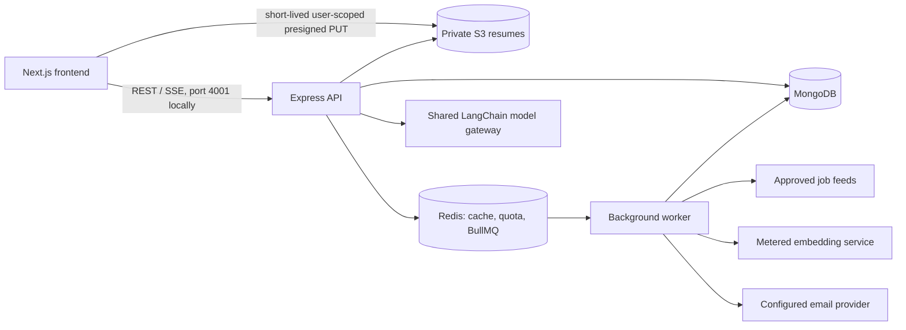
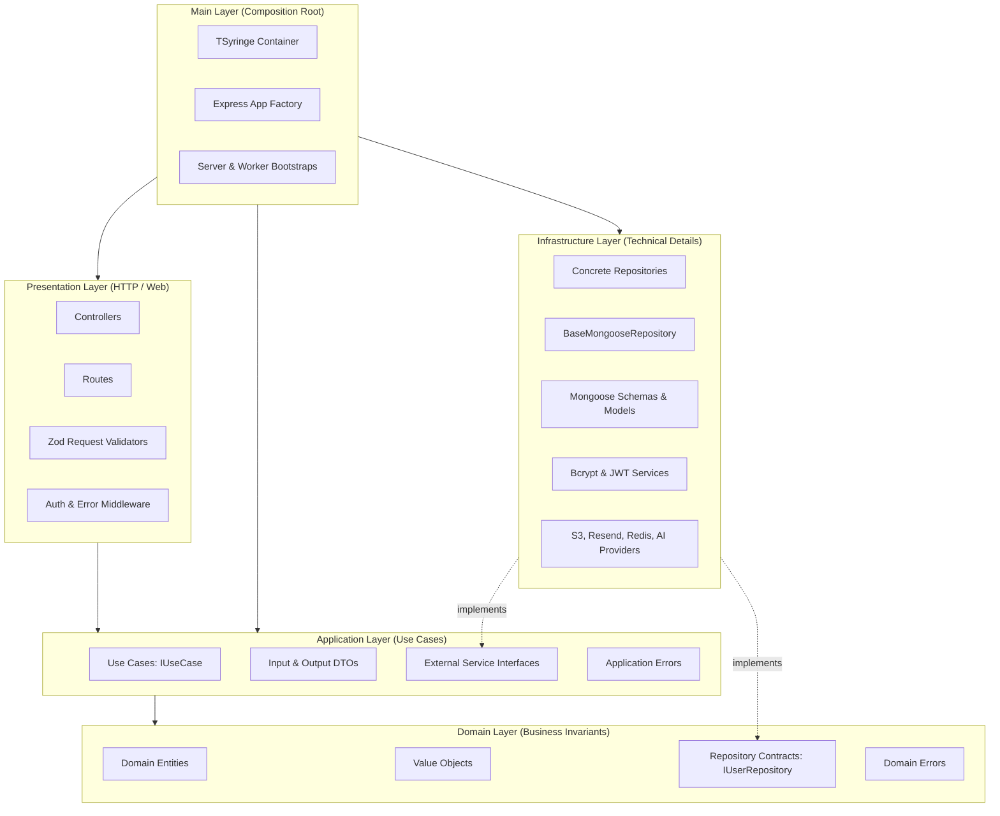

# JobScout Architecture and Technical Specification

Last reviewed: 2026-10-19. This describes the repository implementation, Clean Architecture layers, SOLID principles, dependency injection design, and scaling topology.

---

## 1. System Topology & Services

JobScout uses a Next.js web application, a Node.js/Express API, a separate Node.js worker, MongoDB, Redis/BullMQ, and AWS S3 for private resume objects. API and worker are separate process entry points and can be deployed/scaled independently.



### Core Backend Processes

- **Express API (`src/main/server.ts`)**: Handles authentication, profile/resume APIs, job discovery, application tracking, mock interview simulation, AI chat agent streaming, and payment webhooks.
- **Background Worker (`src/main/worker.ts`)**: Handles scheduled feed ingestion, source health monitoring, repeat schedule reconciliation, email digest generation, and heavy asynchronous jobs via BullMQ.
- **MongoDB**: System of record for users, profiles, resumes, jobs (catalog, details, vectors), application boards, interview sessions, and audit events.
- **Redis**: Fast volatile caching, distributed rate limiting, quota enforcement, and BullMQ task queues.
- **AWS S3**: Secure private storage for uploaded resumes. Client uploads directly via presigned URLs.

---

## 2. Clean Architecture Layers

The backend follows the Dependency Inversion Rule:
$$\text{Presentation} \longrightarrow \text{Application} \longrightarrow \text{Domain} \longleftarrow \text{Infrastructure}$$
The Composition Root is isolated in the `Main` layer.



### 2.1 Domain Layer (`src/domain/`)

- Contains enterprise business entities, value objects, domain rules, and repository contracts.
- **Zero External Dependencies:** Must NEVER import Express, Mongoose, TSyringe, or external libraries.
- **Entities:** `User`, `Profile`, `Job`, `Application`, `InterviewSession`, `Memory`, `ChatSession`.
- **Contracts:** `IUserRepository`, `IProfileRepository`, `IJobRepository`, `IApplicationRepository`, `IInterviewRepository`.
- **Domain Errors:** `DomainError`, `EntityNotFoundError`, `InvariantViolationError`.

### 2.2 Application Layer (`src/application/`)

- Orchestrates application business workflows via single-purpose Use Cases implementing `IUseCase<TInput, TOutput>`.
- Depends ONLY on Domain contracts and abstract infrastructure interfaces (`IPasswordHasher`, `ITokenService`, `IStorageService`, `IEmailService`).
- Uses constructor injection for all dependencies.
- Handles input/output DTO transformations and application validation.

### 2.3 Infrastructure Layer (`src/infrastructure/`)

- Implements technical capabilities and contracts required by inner layers:
  - Database: `BaseMongooseRepository<TDocument, TEntity, TId>`, concrete repositories (`MongooseUserRepository`), models, and mappers.
  - Security: `BcryptPasswordHasher` (implements `IPasswordHasher`), `JwtTokenService` (implements `ITokenService`).
  - Storage & Email: AWS S3 and Resend adapters.
  - AI & LLM: LangChain and provider integrations.

### 2.4 Presentation Layer (`src/presentation/`)

- Manages HTTP/REST boundaries and SSE streaming.
- **Controllers:** Extremely thin; parses request params, invokes appropriate Use Cases, and formats HTTP responses using the common response envelope.
- **Validation:** Request body and parameter validation using Zod schemas at the HTTP boundary before reaching Use Cases.
- **Middleware:** Authentication (`req.user`), CSRF guards, rate limiting, and centralized error handling.

### 2.5 Main Layer (`src/main/`)

- **Composition Root:** `src/main/container.ts` registers all concrete dependencies into TSyringe container using collision-safe symbols.
- Assembles Express application (`app.ts`), route tree (`routes.ts`), and boots HTTP server (`server.ts`) or worker (`worker.ts`).

---

## 3. SOLID Principles in Practice

1. **Single Responsibility Principle (SRP):**
   - Controllers handle only HTTP status codes, headers, and payload serialization.
   - Use Cases encapsulate a single business flow (e.g. `RegisterUserUseCase`).
   - Repositories encapsulate database queries and translation to domain entities.
2. **Open/Closed Principle (OCP):**
   - New job source adapters or AI providers implement common interfaces (`BaseAdapter`, `ILlmProvider`) without modifying core ingestion or chat logic.
3. **Liskov Substitution Principle (LSP):**
   - In-memory mock repositories and concrete Mongoose repositories honor identical interface contracts, enabling fast, isolated testing.
4. **Interface Segregation Principle (ISP):**
   - Focused interfaces (e.g. `IPasswordHasher`, `ITokenService`) instead of bloated helper god-interfaces.
5. **Dependency Inversion Principle (DIP):**
   - High-level use cases depend on abstract repository interfaces (`IUserRepository`), not concrete database models.

---

## 4. TSyringe Dependency Injection Design

- **Tokens:** Centralized injection tokens defined in `src/shared/constants/injectionTokens.ts`:
  ```typescript
  export const TOKENS = {
    UserRepository: Symbol.for("IUserRepository"),
    ProfileRepository: Symbol.for("IProfileRepository"),
    ResumeRepository: Symbol.for("IResumeRepository"),
    JobRepository: Symbol.for("IJobRepository"),
    ApplicationRepository: Symbol.for("IApplicationRepository"),
    InterviewRepository: Symbol.for("IInterviewRepository"),
    FeedbackRepository: Symbol.for("IFeedbackRepository"),
    CatalogVersionRepository: Symbol.for("ICatalogVersionRepository"),
    SavedSearchRepository: Symbol.for("ISavedSearchRepository"),
    JobMatchReportRepository: Symbol.for("IJobMatchReportRepository"),
    AdminRepository: Symbol.for("IAdminRepository"),
    InteractionEventRepository: Symbol.for("IInteractionEventRepository"),
    FxRateRepository: Symbol.for("IFxRateRepository"),
    UsageEventRepository: Symbol.for("IUsageEventRepository"),
    MatchRefreshRepository: Symbol.for("IMatchRefreshRepository"),
    TrackedCompanyRepository: Symbol.for("ITrackedCompanyRepository"),
    DocumentRepository: Symbol.for("IDocumentRepository"),
    PrivacyRepository: Symbol.for("IPrivacyRepository"),
    InterviewSessionRepository: Symbol.for("IInterviewSessionRepository"),
    ResumeMatchReportService: Symbol.for("IResumeMatchReportService"),
    PasswordHasher: Symbol.for("IPasswordHasher"),
    TokenService: Symbol.for("ITokenService"),
    StorageService: Symbol.for("IStorageService"),
    EmailService: Symbol.for("IEmailService"),
  } as const;
  ```
- **Constructor Injection:**
  ```typescript
  @injectable()
  export class RegisterUserUseCase implements IUseCase<RegisterUserDTO, AuthResultDTO> {
    constructor(
      @inject(TOKENS.UserRepository) private readonly userRepository: IUserRepository,
      @inject(TOKENS.PasswordHasher) private readonly passwordHasher: IPasswordHasher,
      @inject(TOKENS.TokenService) private readonly tokenService: ITokenService
    ) {}

    async execute(input: RegisterUserDTO): Promise<AuthResultDTO> { ... }
  }
  ```
- **Lifecycles:**
  - Singleton: Database connection managers, Redis clients, Logger, Repository instances.
  - Transient: Request DTOs, Use Cases.

---

## 5. Repository Pattern & Base Repository

A strongly typed base repository `BaseMongooseRepository<TDocument, TEntity, TId>` encapsulates common CRUD, pagination, and projection patterns while allowing feature-specific query optimizations in concrete repositories:

```typescript
export abstract class BaseMongooseRepository<TDoc extends Document, TEntity, TId = string> {
  constructor(protected readonly model: Model<TDoc>) {}

  abstract toEntity(doc: TDoc): TEntity;
  abstract toPersistence(entity: Partial<TEntity>): Record<string, unknown>;

  async findById(id: TId): Promise<TEntity | null> {
    const doc = await this.model.findById(id).lean();
    return doc ? this.toEntity(doc as unknown as TDoc) : null;
  }
}
```

---

## 6. Common Response Model & Centralized Error Handling

### 6.1 Success Responses

All successful REST endpoints format responses using the standard envelope:

```json
{
  "data": { ... }
}
```

### 6.2 Error Responses

Application and Domain errors extend a typed `AppError` base class. The presentation `errorHandler` catches and maps them to HTTP responses:

```json
{
  "error": {
    "code": "EMAIL_ALREADY_EXISTS",
    "message": "An account with this email already exists",
    "details": [],
    "requestId": "req_12345"
  }
}
```

| Error Category                | Typical Status     | Example Error Code                           | Handling                                 |
| ----------------------------- | ------------------ | -------------------------------------------- | ---------------------------------------- |
| Domain Validation / Invariant | 400 Bad Request    | `INVALID_PAYLOAD`, `INVARIANT_VIOLATION`     | Zod issues / domain rule description     |
| Authentication                | 401 Unauthorized   | `INVALID_CREDENTIALS`, `TOKEN_EXPIRED`       | Clear cookies & prompt re-login          |
| Authorization / Quota         | 403 Forbidden      | `FORBIDDEN`, `QUOTA_EXCEEDED`                | Explains missing privilege or tier limit |
| Resource Not Found            | 404 Not Found      | `USER_NOT_FOUND`, `JOB_NOT_FOUND`            | Standard 404 envelope                    |
| Conflict / Duplicate          | 409 Conflict       | `EMAIL_ALREADY_EXISTS`, `DUPLICATE_RESOURCE` | State explanation                        |
| Internal Infrastructure       | 500 Internal Error | `INTERNAL_SERVER_ERROR`                      | Captured to Sentry, sanitized in prod    |

---

## 7. Scaling and Capacity Plan

- **Marginal Catalog Costs:** Catalog storage is optimized via split collections (`Job`, `JobDetail`, `JobVector`). Hot documents remain $\le 2\text{ KB}$ for fast index scans.
- **Process Separation:** API and Worker are isolated, preventing ingestion spikes from degrading user request latency.
- **Ingestion Resilience:** Source feeds use circuit breakers (`opossum`), backoff, dead-letter queues, and per-source rate budgets.

---

## 8. Quality Controls, Boundaries & Forwarding Compatibility

### 8.1 Canonical Mongoose Models vs. Forwarder Facades

All canonical Mongoose models, schemas, and compound indexes reside under `src/infrastructure/database/mongoose/models/*Model.ts`.
To maintain non-breaking operational compatibility across existing maintenance scripts (`scripts/*.js`) and background workers, `src/models/*.ts` provides thin, 1-line re-export forwarders to the canonical infrastructure models.

### 8.2 Consolidated Presentation Layer

The HTTP presentation layer is consolidated under `src/presentation/http/`:

- `routes/index.ts`: The unified API router mounted at `/api/v1` in `src/main/app.ts`.
- `controllers/`: Handles request parsing, invokes application use cases, and returns structured API envelopes.
- `middleware/`: Houses HTTP-specific middlewares (`authMiddleware`, `errorHandlerMiddleware`, `csrfProtection`).

### 8.3 Automated Architectural Boundaries (`npm run check:architecture`)

Clean Architecture dependencies are strictly validated by `scripts/check-architecture.mjs`:

- **Domain Independence:** `src/domain` has zero imports from Mongoose, Express, Redis, BullMQ, AWS, or AI SDKs.
- **Use Case Abstraction:** `src/application/useCases` depends on domain interfaces rather than concrete infrastructure adapters.
- **Infrastructure Decoupling:** `src/infrastructure` has zero imports from presentation controllers.
- **Strict Typing:** Strictly 0 explicit `any` type annotations across all 258 `src/` source files.
