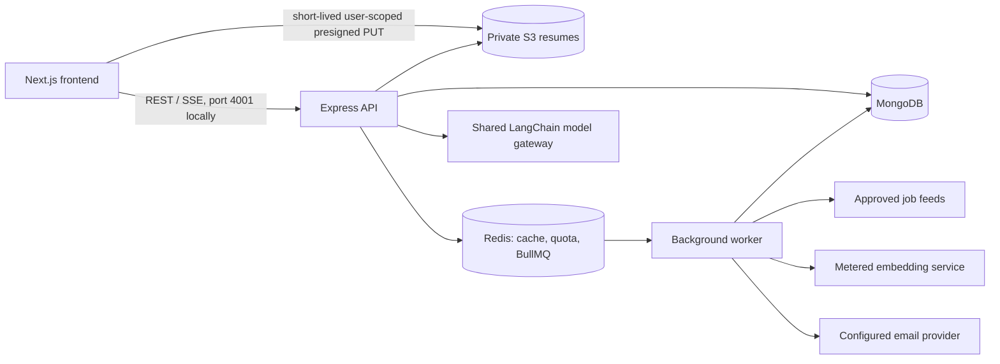

# JobScout architecture and scaling plan

Last reviewed: 2026-10-16. This describes the repository implementation; it does not assert a particular production topology. See the separately maintained frontend repo at `../Ai_resume_frontend`.

## System at a glance

JobScout uses a Next.js web application, a Node.js/Express API, a separate Node.js worker, MongoDB, Redis/BullMQ, and AWS S3 for private resume objects. API and worker are separate process entry points and can be deployed/scaled independently. The exact hosting provider, production replica counts, Atlas tier, Redis tier, and S3 lifecycle configuration are **Unverified** here.

## Backend services

- **Express API (`src/server.js`)** handles authentication, owner-scoped profile/resume APIs, job search and matching, application tracking, billing webhooks, and chat/interview streaming. User requests do not trigger source ingestion.
- **Worker (`src/worker.js`)** handles scheduled job ingestion and bounded/background work through BullMQ. Its Mongo/Redis dependencies and concurrency are independent of the HTTP process.
- **MongoDB** is the system of record for users, profile/resume metadata and encrypted extracted text, jobs, source registry/run state, applications, interviews and usage events. Schemas and indexes live in `src/models`.
- **Redis** provides cache/quota coordination and BullMQ state. Production AI paid calls fail closed when the durable quota store is unavailable. The exact hosted Redis topology is deployment-configured.
- **AWS S3** stores private resume files. The browser receives a short-lived, user-prefix-scoped presigned URL; API completion verifies ownership and is idempotent.
- **AI integrations** go through the shared LangChain invocation layer and model catalog. Embeddings use their dedicated quota- and kill-switch-aware service. Job matching remains deterministic and LLM-free in its hot path.
- **Job feeds** are selected through a source registry and policy gate. Only currently enabled/approved registry sources are ingested; the catalog is not the whole internet.

## Frontend services

The separate `Ai_resume_frontend` repository is a Next.js App Router application. Pages compose shared React components, design tokens and API operations in `src/lib/api`. Authentication is cookie-based; server/API origins and permitted browser connections are environment/configuration controlled. Resume file bytes go from browser directly to the scoped S3 presigned URL, while metadata and completion are sent to the backend API.

The frontend is static/server rendered where appropriate and makes authenticated API calls for user data. It does not own business rules, billing enforcement, quota checks, matching, or provider keys. The backend remains the authorization and validation boundary.

## Current request and ingestion flows

1. Browser makes an authenticated REST request to the API.
2. The API validates schemas, obtains identity from authenticated server state, checks owner and plan/consent gates, and reads/writes MongoDB or Redis.
3. Expensive or repeatable work is queued to the existing worker where appropriate; the worker uses the same Mongo/Redis stores.
4. Resume upload uses a presigned browser PUT to S3; completion is an API operation that validates the user's key, file metadata and consent before parsing.
5. Scheduled source adapters fetch only policy-approved sources, normalize and deduplicate by source identity, and update changed job documents. Discovery reads the indexed catalog only.

## Scaling in stages

These are scale options, not current deployed capacity commitments. Use observed latency, queue age, Mongo explain plans, Redis utilization and provider spend before increasing resources.

### Marginal catalog cost scenarios

Production monthly invoices cannot be calculated from this repository because the MongoDB/Redis/worker hosting tiers, region, replica counts, ingestion cadence and provider billing account are not specified. The following bounded estimate isolates embedding API spend and catalog document volume; it is not a total infrastructure bill. It uses the configured `text-embedding-3-small` rate of $0.02 per million input tokens and a measured 6,174-byte average raw description (~1,544 tokens at an illustrative four characters/token). It assumes every job is new or changed in the month; because the worker caches/embeds only changed jobs, 10% monthly change costs one tenth.

| Catalog jobs | Logical BSON size at 28,807 bytes/job | One full new/changed pass of embeddings | At 10% monthly change |
|---:|---:|---:|---:|
| 10,000 | ~0.29 GB | ~$0.31/month | ~$0.03/month |
| 100,000 | ~2.88 GB | ~$3.09/month | ~$0.31/month |
| 1,000,000 | ~28.81 GB | ~$30.88/month | ~$3.09/month |

The token estimate uses raw-description bytes only; title, company and requirements add a small amount, while provider tokenization may differ. The measured document size includes the existing 1,536-dimension vector and raw description. BSON volume excludes indexes, MongoDB compression, replication, backups and storage tier minimums. Source API costs are zero for the currently configured public feeds within their allowed quotas, but quota limits and terms still apply. API/worker compute, MongoDB, Redis, S3, backups, logs, and bandwidth are **Unverified** and excluded; use the actual provider bill before capacity or budget decisions. Cost controls are content-hash skip, batching, changed-only embeddings, bounded candidate retrieval, and no per-job LLM scoring.

### Current architecture: one API and one worker process

- Keep API and worker as distinct processes, even if they share an image, so expensive ingestion cannot block request handling.
- Use existing Mongo indexes and bounded candidate retrieval; keep the discovery pool capped and matching deterministic.
- Use existing Redis queues/cache/quota paths and per-source quotas. Keep retry counts bounded and avoid duplicate provider work with content hashes/idempotency keys.
- Upload resume bytes directly to S3 instead of proxying them through the API.
- Monitor API p95/error rate, worker queue age, per-source request budget, Mongo examined/returned ratio, Redis health, and AI usage before scaling.

### Increased traffic: scale existing processes horizontally

- Add stateless API replicas behind the existing load balancer; keep secrets/config identical and session/auth state in the shared stores.
- Increase worker replicas or queue concurrency gradually by workload type. Preserve per-source rate limits and AI quotas across replicas using Redis-backed coordination.
- Tune Mongo connection pools and query/index patterns before upgrading the database tier. Check `explain()` and queue-backed write pressure.
- Apply S3 lifecycle/retention and least-privilege IAM only after the intended policy is reviewed; no bucket lifecycle was changed here.

### Larger catalog or sustained bottlenecks

- Partition worker queues by task/source only when queue-age metrics show contention. Keep a single source registry and durable cursors.
- Consider a separate Mongo collection for high-volume vectors only after a measured size/latency case and migration/rollback review; existing vectors are not moved or deleted.
- Consider a dedicated search index or database only when bounded Mongo queries fail measured p95/throughput goals. This requires approval because it adds infrastructure and operational cost.
- Add autoscaling from sustained CPU, latency and queue-age signals with hard cost ceilings; do not scale from instantaneous job count alone.
- Introduce regional deployment, event bus, or service decomposition only when latency/residency/availability requirements justify their added cost and failure modes.

## Development and local startup

Use the backend `npm run dev:stack` command to start the API, worker and sibling frontend together when local prerequisites (MongoDB and Redis) are available. Ports: frontend 3000, API 4001. Separate commands are documented in the root `AGENTS.md` and each repo's README. Never paste `.env` values into logs or reports.

## Operational gaps

- Production host/replica count, MongoDB and Redis service tiers, autoscaling policy, backup RPO/RTO, S3 lifecycle and observability thresholds must be verified against deployment configuration.
- Monthly spend depends on hosting tiers, job source quotas, model selection/usage, embedding calls, retention and traffic; no paid service or infrastructure was added by this change.
- This document is a topology/scaling guide, not a capacity guarantee. Benchmark with representative data before setting numeric SLOs.
