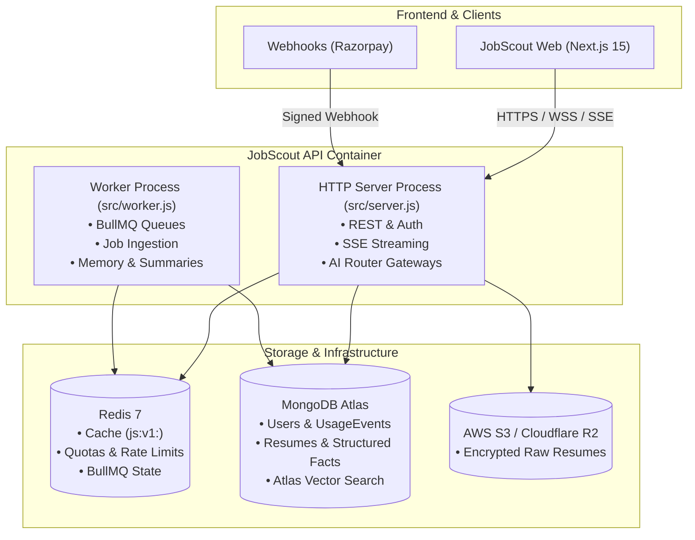
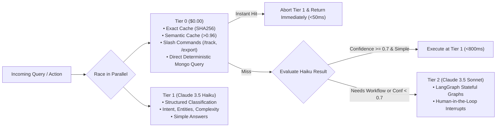

# JobScout Architecture Documentation

## 1. System Topology & Dual-Process Design

JobScout API (`jobscout-api`) is engineered as a standalone, enterprise-grade backend service built with Node.js 22 LTS and Express.js (pure JavaScript ES Modules, JSDoc types, and Zod runtime schema validation).

A single production Docker image powers two independently scalable processes:

1. **HTTP Server Process (`src/server.js`)**:
   - Handles REST API requests, auth cookies, file uploads, billing webhooks, and Server-Sent Events (SSE) streaming for chat and LangGraph workflow progress.
   - Uses non-blocking asynchronous event loops, connection pooling to MongoDB Atlas, and Redis for caching and rate limiting.
2. **Background Worker Process (`src/worker.js`)**:
   - Dedicated BullMQ worker consuming scheduled discovery tasks (`ingestJobs`, `dailyMatch`), thread summarization, memory extraction, delayed follow-up reminders, and email digest dispatches via Resend.
   - Can be scaled to $N$ replicas horizontally without affecting API request latencies.

---

## 2. The 3-Tier AI Router & Cost-Optimization Engine

The AI Router (`src/ai/router.js`) sits between incoming candidate requests and LLM model invocations. Its primary goal is keeping **70–80% of all traffic on Tier 0 or Tier 1**, protecting operational margins.

### Routing Tiers

- **Tier 0 (Zero Cost)**:
  - Exact match lookup on Redis: `SHA256(normalizedPrompt + contextVersion)`.
  - Generic non-personal semantic cache in MongoDB `semanticCache` with cosine similarity > 0.96.
  - Slash commands: `/track`, `/status`, `/export`, `/stats`.
  - Deterministic queries: "show my applications" directly triggers MongoDB aggregation without sending tokens to any model.
- **Tier 1 (Small Model: Claude 3.5 Haiku)**:
  - Single fast structured Zod output call yielding `{ intent, complexity, needsTools, needsMemory, confidence, entities }`.
  - Handles simple conversations, facts extraction, and basic job categorization.
- **Tier 2 (Strong Model: Claude 3.5 Sonnet + LangGraph)**:
  - Triggered only when confidence < 0.7, validation fails, or intent explicitly requires a heavy graph workflow (`match_jobs`, `tailor_resume`, `interview_prep`, `full_strategy`).

---

## 3. LangGraph Workflow Architectures

All stateful graph executions utilize `@langchain/langgraph-checkpoint-mongodb`, enabling jobs to pause for human approval, recover from server restarts, and stream progress events over SSE.

### Graph A: Scheduled Job Discovery

1. **Fetch**: Query public job APIs (Adzuna, RemoteOK, Greenhouse, Lever, Ashby) with rate limiters.
2. **Deduplicate**: Compute SHA256 of normalized title, company, and location. Skip already ingested jobs.
3. **Embed Once**: Compute vector embedding via Voyage/OpenAI once per unique job; index in Atlas Vector Search (shared across all users).
4. **Vector Match**: Cosine similarity against candidate profile embeddings.
5. **Rule Filter**: Strict filtering on location, salary expectations, and remote preferences.
6. **Rerank**: Small model (Haiku) reranks top 30 truncated job descriptions.
7. **Explain Top 10**: Generate match rationales and skill gap analyses.
8. **Store & Digest**: Precompute dashboard matches and queue daily email digest.

### Graph B: Resume Tailoring with Mandatory Truthfulness

1. **Parse JD**: Extract core requirements and keywords (cached for 30 days).
2. **Map to Facts**: Match candidate's structured profile facts (`factId` registry) to job requirements.
3. **Draft Resume**: Generate targeted experience bullets.
4. **Truthfulness Check**: Mandatory validation node. Every generated bullet **must** link to a candidate `factId`. If any claim is unsupported, the graph rejects and regenerates (max 2 retries). Hallucinating credentials or experience is strictly forbidden.
5. **ATS Keyword Check**: Calculate keyword density and semantic match score.
6. **Interrupt Node**: `interrupt()` pauses graph execution, awaiting candidate review and edits in the frontend UI.
7. **Export**: Generates ATS-friendly PDF and DOCX files only after explicit candidate approval.

### Graph C: Interview Prep & Mock Interview Loop

1. **Company Research**: Scrape and synthesize recent news, culture, and tech stack (cached 7 days).
2. **Question Bank**: Generate behavioral and technical questions tailored to the target role.
3. **STAR Stories**: Align candidate's real profile achievements into Situation-Task-Action-Result format.
4. **Mock Interview Loop**: Stateful multi-turn Q&A loop (hard-capped at 5 turns) with real-time scoring.
5. **Feedback Report**: Actionable evaluation summary with areas of strength and improvement.

### Graph D: Application Manager & Follow-Ups

1. **Status Change**: Update application status (saved &rarr; applied &rarr; interviewing &rarr; offer).
2. **Follow-Up Scheduler**: Compute follow-up delay (e.g., 5 business days) and schedule BullMQ job.
3. **Draft Email**: Generate context-aware follow-up email.
4. **Interrupt Node**: Graph pauses for candidate approval; email is **never** sent automatically.
5. **Send**: Dispatches via Resend upon explicit candidate approval.

---

## 4. Multi-Layer Caching Map

All caching is routed through the single helper `src/shared/cache.js` under the namespace `js:v1:`:

| Key Pattern                             | TTL        | Shared vs Private | Purpose                                          |
| :-------------------------------------- | :--------- | :---------------- | :----------------------------------------------- |
| `js:v1:resp:{userId}:{resource}:v{ver}` | 30–120s    | Private           | User dashboard and query response cache          |
| `js:v1:mem:pinned:{userId}:v{ver}`      | 24 hours   | Private           | Pinned user profile facts and core preferences   |
| `js:v1:sess:{userId}:{threadId}`        | 24 hours   | Private           | Short-term chat history (last 8 turns)           |
| `js:v1:exact:{sha256}`                  | 1–24 hours | Mixed             | Exact prompt hash hit (non-personalized)         |
| `semanticCache` (MongoDB)               | 7 days     | Shared            | Generic non-personal queries (similarity > 0.96) |
| `js:v1:jd:{hash}`                       | 30 days    | Shared            | Parsed job descriptions and requirements         |
| `js:v1:emb:{hash}`                      | 90 days    | Shared            | Job vector embeddings (Voyage/OpenAI)            |
| `js:v1:co:{slug}`                       | 7 days     | Shared            | Company background, tech stack, and news         |
| `js:v1:rp:{fileHash}`                   | 30 days    | Private           | Parsed resume structured facts                   |
| `js:v1:board:{userId}:v{ver}`           | 60 seconds | Private           | Kanban application tracker board state           |
| `js:v1:lock:{key}`                      | 10–30s     | System            | Distributed single-flight lock (`SET NX PX`)     |

### Single-Flight & Fail-Open Philosophy

- **Single-Flight Lock**: `getOrSet(key, computeFn)` acquires a Redis lock to eliminate cache stampedes when expensive operations (like JD parsing or LLM explanations) are triggered simultaneously.
- **Fail-Open Resilience**: If Redis experiences an outage, read operations bypass the cache transparently without crashing.
- **Fail-Closed Quotas**: For expensive Tier 2 actions, quota verification fails closed if limits cannot be checked, preventing unauthorized cost overruns.
