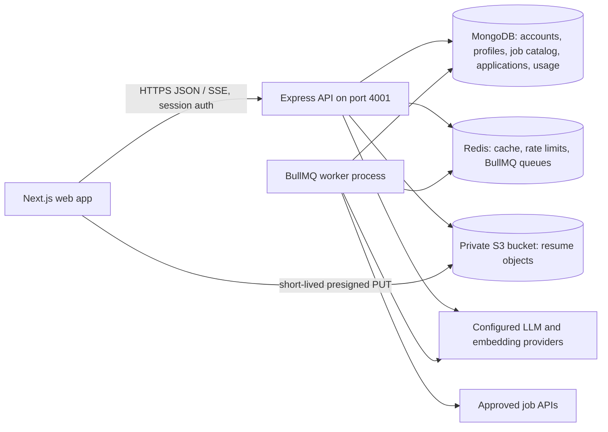

# JobScout architecture and scaling plan

This document describes the current product boundary and a staged way to scale it while continuing to use the existing MongoDB, Redis, S3, and worker setup. It is a planning guide, not a claim that future infrastructure is already deployed.

## Current high-level architecture

### Frontend

- Next.js App Router renders the public site and signed-in workspace.
- Shared layout, design tokens, reusable UI primitives, and page components live in the frontend repository.
- Browser requests use the shared API client and cookie/session contract; API base URL is configured for the local API on port 4001.
- Resume bytes go directly to private S3 through a short-lived, key-scoped presigned URL. The browser calls the API to complete and process the upload; it never receives AWS credentials.

### Backend

- Express exposes versioned REST endpoints and streaming responses. Authentication, authorization, validation, CSRF, rate limits, and plan/quota checks sit at the API boundary.
- Domain logic is split among controllers, repositories, services, and Mongo models. LLM providers are routed through shared provider boundaries; user-facing job matching remains deterministic and LLM-free in its hot path.
- MongoDB stores user data, job/application records, source registry state, and usage ledgers. New job ingestion adds collections/indexes inside MongoDB only.
- Redis supports cache, rate limits, distributed locks, and BullMQ. A separate worker process handles scheduled ingestion and existing asynchronous work.
- S3 stores private resume files. Mongo holds object keys and metadata, not file bytes.
- Job discovery reads the indexed Mongo catalog only. The worker reconciles per-source schedules, tracks cursors/quotas/health, refreshes the ECB daily FX snapshot, and runs the additive classification/eligibility pipelines. Job matching stays deterministic and LLM-free; new embeddings are off by default.
- The job-source registry is a policy gate: source terms, attribution, retention, quota, verification date, approval, and enablement are recorded independently. Employer ATS requests remain pending until validation and administrator review; Adzuna stays disabled pending license and display-policy review.

## Current job ingestion and discovery flow

1. The worker schedules an approved source using its Mongo registry interval and quota.
2. An adapter makes bounded HTTP requests, normalizes source IDs, source URLs, dates, salary, location, provenance, and descriptions, and persists the cursor after each page.
3. Identity resolves by `(source, sourceJobId)`, then source canonical URL, then normalized company/title/location. Similarity is never used for dedupe.
4. The job content hash covers the text used for matching. Unchanged jobs reuse their stored vector; changed records re-embed only if that matching text changed. New/changed vectors are sent in batches and cached by content hash plus provider/model/dimension.
5. Discovery only reads active, non-expired Mongo records. It applies structured filters, caps candidates at 300 in the matching graph (400 at service boundary), then scores lexical job/profile features deterministically. It does not compare vectors in the current hot path and does not trigger ingestion.

Current approved sources are Remote OK, Remotive, and Jobicy. Coverage is limited to those sources and their respective terms and update windows; the catalog is not the whole internet. Other sources remain disabled until their terms are reviewed and the owner approves them.

## Scaling in stages

### Current stage: existing services

- Keep API and workers as separate process roles; scale their replica counts independently on the existing host/container platform.
- Keep worker concurrency modest. Source quotas and Mongo run leases prevent a replica increase from multiplying feed requests.
- Keep discovery reads bounded and project only the required fields. Retain compound indexes for active jobs, location/work mode, occupation, and source coverage; verify each production query with `explain("executionStats")` after data growth.
- Job embeddings are disabled by default (`JOB_EMBEDDINGS_ENABLED=false`). When enabled, only new/changed matching text is embedded in batches through the existing metered boundary; expired jobs are not re-embedded. Discovery currently remains lexical and does not consume these vectors.
- Monitor the per-source request budget, worker lag, Mongo query latency/pool saturation, Redis latency/memory, API p95, and provider spend before increasing concurrency.

### Growth stage: tune the same MongoDB and Redis

1. Add API replicas when API CPU or latency saturates; keep stateless session/auth configuration identical across replicas.
2. Add worker replicas only when queue lag grows and provider quotas permit it. Keep source locks/quota checks in Mongo so replicas remain coordinated.
3. Tune Mongo connection-pool sizes, indexes, candidate caps, projections, and storage retention using measured query plans and Atlas metrics. Avoid large unbounded `lean()` reads from job discovery.
4. Set explicit retention and archival rules before catalog size causes indexes or vectors to dominate. The default embedding configuration is OpenAI `text-embedding-3-small` at 1,536 dimensions; the alternate default Voyage configuration is `voyage-large-2-instruct` at 1,024 dimensions. Embeddings are off by default. A 1,536-element BSON numeric array is roughly 19.5 KB before document/index overhead; use `npm run jobs:bson:measure` on the local catalog for the current sample and do not treat this estimate as an Atlas bill.
5. Increase batch size or lower embedding dimensions only after a representative matching-quality evaluation; changing dimensions requires a versioned vector namespace and an approved re-embedding rollout.

### Future stage: only after measured limits and separate approval

- Partition high-volume ingestion and API workloads further by queue or worker role while keeping the same MongoDB and Redis.
- Consider Mongo sharding, a dedicated search/vector system, a new queue, or an external analytics store only when measured limits show the current services cannot meet the product SLO. These are not part of the current architecture or this delivery.
- Add new feed integrations from a curated employer registry or other reviewed sources only after legal/terms verification and explicit approval. Do not scrape held sources.

## Operational thresholds to review

There are no invented hard alerts here because current production SLOs and hosting limits were not supplied. Establish baselines first. Review scaling when any of these hold over a sustained window: discovery p95 exceeds its product target, Mongo execution plans scan far more documents than they return, worker backlog grows faster than it drains, Redis memory/latency approaches its configured limit, or embedding/LLM spend exceeds its monthly budget. Scale one bottleneck at a time and compare before/after telemetry.

## References

- Backend setup and service details: `AiJob_search_backend/README.md`.
- Frontend architecture and API contract: `Ai_resume_frontend/docs/architecture/SYSTEM_ARCHITECTURE.md` and `Ai_resume_frontend/docs/api/API_INTEGRATION.md`.
- Job source registry, migration, quotas, cost assumptions, and rollback: `AiJob_search_backend/docs/JOB_CATALOG_INGESTION.md`.

## FX source and attribution

The daily ECB reference-rate adapter remains the only active provider. Rates are informational only, not for transactions; the ECB framework says the rates are not intended to be used in market transactions. Set `FX_REFERENCE_SOURCE=ecb` (the default). `rbi` and `fbil` are reserved config choices and fail explicitly until their provider adapter and terms are cleared. RBI discontinued daily reference-rate publication on 2018-07-09. FBIL took over on 2018-07-10; its published fee schedule says reference-rate use is fee-liable. Do not select FBIL without a usage license. See [ADR 0009](ai/adr/0009-ecb-daily-fx-rates.md).
