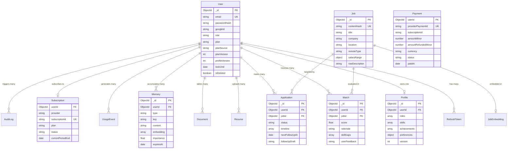

# Database Architecture & Schema Design

## 1. Storage Topology Overview

JobScout API employs a multi-tiered data persistence architecture:

1. **MongoDB Atlas**: Primary operational document store containing users, profiles, jobs, applications, memories, subscriptions, and telemetry collections.
2. **Atlas Vector Search**: High-dimensional vector indexing for job postings and candidate long-term memories using Approximate Nearest Neighbor (ANN) search with cosine similarity.
3. **Redis 7**: L1 response caching, semantic and exact prompt hash caches, single-flight distributed locking, session tokens, and rate-limit/quota counters.
4. **AWS S3 / Cloudflare R2**: Object storage for original and generated PDF/DOCX resumes and cover letters.

---

## 2. Entity-Relationship Diagram (ERD)



---

## 3. Detailed Collection Schemas

### 3.1. `users`

Core identity, subscription state, security lockout, and refresh token families.

```javascript
{
  _id: ObjectId,
  email: String,                   // unique, lowercase, indexed
  passwordHash: String,            // bcrypt (cost 12), nullable for Google OAuth
  googleId: String,                // sparse index
  name: String,
  role: String,                    // enum: ["user", "admin", "super_admin"]
  plan: String,                    // enum: ["free", "pro", "premium"]
  planSource: String,              // enum: ["manual", "admin", "razorpay"]
  planVersion: Number,             // bumped on plan upgrade/downgrade for cache invalidation
  profileVersion: Number,          // bumped on resume/profile update
  subscriptionId: String,          // Razorpay subscription ID
  subscriptionProvider: String,    // enum: ["razorpay", null]
  subscriptionStatus: String,      // enum: ["active", "past_due", "canceled", "trialing"]
  gracePeriodUntil: Date,          // 7-day grace period for failed payments
  failedLoginAttempts: Number,     // counter for account lockout
  lockUntil: Date,                 // lockout timestamp (15 minutes after 5 failures)
  refreshTokens: [
    {
      tokenHash: String,           // SHA256 hash of refresh token
      familyId: String,            // cryptographic family ID for reuse detection
      expiresAt: Date,             // 7-day expiry
      isRevoked: Boolean
    }
  ],
  memoryPaused: Boolean,           // user toggle to pause long-term memory capture
  isDeleted: Boolean,              // soft delete flag (default false)
  deletedAt: Date,
  createdAt: Date,
  updatedAt: Date
}
```

**Indexes**:

- `{ email: 1, isDeleted: 1 }` (unique compound)
- `{ googleId: 1 }` (sparse)
- `{ plan: 1 }`

---

### 3.2. `profiles`

The parsed canonical career data represented as immutable **STRUCTURED FACTS**, each with a globally unique `factId` (nanoid).

```javascript
{
  _id: ObjectId,
  userId: ObjectId,                // ref: "User", unique index
  roles: [
    {
      factId: String,              // nanoid, e.g., "fact_role_98xLa"
      title: String,
      company: String,
      startDate: String,
      endDate: String,
      isCurrent: Boolean,
      achievements: [
        {
          factId: String,          // e.g., "fact_ach_28kLz"
          bullet: String,          // verified candidate achievement
          metrics: String          // e.g., "reduced latency by 42%"
        }
      ]
    }
  ],
  skills: [
    {
      factId: String,              // e.g., "fact_skl_11mNa"
      name: String,                // e.g., "Kubernetes", "Node.js"
      category: String,            // enum: ["language", "framework", "cloud", "soft"]
      proficiencyYears: Number
    }
  ],
  education: [
    {
      factId: String,              // e.g., "fact_edu_44pQz"
      degree: String,
      institution: String,
      graduationYear: Number
    }
  ],
  preferences: {
    targetRoles: [String],
    minimumSalaryUsd: Number,
    preferredLocations: [String],
    remotePreference: String       // enum: ["remote", "hybrid", "onsite", "any"]
  },
  careerProfile: Object,           // optional validated v1 profile; no default language values
  version: Number,                 // profile version counter
  createdAt: Date,
  updatedAt: Date
}
```

The additive careerProfile stores explicit target-role selections, confirmed/derived experience, home and target locations, work authorization, work preferences, compensation with currency and period, and optional education/language/test-score/availability/certification details. It remains owner-scoped with the profile document. Migration is report-only until approved; existing legacy fields remain compatible. Career-profile suggestions and derived years are not saved unless the user confirms them.

---

### 3.3. `resumes`

Original uploaded resume records with field-level encryption.

```javascript
{
  _id: ObjectId,
  userId: ObjectId,                // ref: "User", index
  fileHash: String,                // SHA256 of file buffer for 30d parse cache
  originalFilename: String,
  mimeType: String,                // "application/pdf" or "application/vnd.openxmlformats..."
  s3Key: String,                   // object storage pointer
  encryptedRawText: {
    cipherText: String,            // AES-256-GCM ciphertext
    iv: String,                    // 12-byte initialization vector
    tag: String,                   // 16-byte authentication tag
    keyVersion: String             // e.g., "v1"
  },
  parsedFactsCount: Number,
  createdAt: Date
}
```

---

### 3.4. `jobs` & `jobEmbeddings`

Ingested and deduplicated public job opportunities.

```javascript
// jobs Collection
{
  _id: ObjectId,
  contentHash: String,             // SHA256(normalizedTitle + company + location), unique index
  title: String,
  company: String,
  companySlug: String,
  location: String,
  remoteType: String,              // enum: ["remote", "hybrid", "onsite"]
  salaryRange: {
    min: Number,
    max: Number,
    currency: String               // e.g., "USD", "INR"
  },
  requirements: [String],
  tags: [String],
  rawDescription: String,
  sourceBoard: String,             // enum: ["adzuna", "remoteok", "greenhouse", "lever", "ashby"]
  sourceUrl: String,
  postedAt: Date,
  expiresAt: Date,                 // TTL index: automatically deleted after 60 days
  createdAt: Date
}

// jobEmbeddings Collection (Atlas Vector Search Target)
{
  _id: ObjectId,
  jobId: ObjectId,                 // ref: "Job", unique index
  contentHash: String,             // shared embedding cache index
  embedding: [Number],             // 1536-dim vector (OpenAI text-embedding-3-small) or 1024 (Voyage)
  provider: String,                // "openai" or "voyage"
  createdAt: Date
}
```

**Atlas Vector Search Index Definition**:

```json
{
  "mappings": {
    "dynamic": true,
    "fields": {
      "embedding": {
        "dimensions": 1536,
        "similarity": "cosine",
        "type": "knnVector"
      }
    }
  }
}
```

---

### 3.5. `matches`

Candidate-specific evaluation scores and skill-gap breakdowns.

```javascript
{
  _id: ObjectId,
  userId: ObjectId,                // ref: "User", index
  jobId: ObjectId,                 // ref: "Job", index
  score: Number,                   // 0 to 100 percentage
  rationale: String,               // LLM explanation of why candidate matches
  matchingSkills: [String],
  missingSkills: [String],         // skill-gap analysis
  userFeedback: String,            // enum: ["thumbs_up", "thumbs_down", null]
  feedbackReason: String,
  createdAt: Date
}
```

**Indexes**:

- `{ userId: 1, jobId: 1 }` (unique compound)
- `{ userId: 1, score: -1 }` (compound for top matches query)

---

### 3.6. `documents` (Tailored Resumes & Cover Letters)

Generated documents undergoing human-in-the-loop review.

```javascript
{
  _id: ObjectId,
  userId: ObjectId,                // ref: "User", index
  jobId: ObjectId,                 // ref: "Job"
  type: String,                    // enum: ["tailored_resume", "cover_letter"]
  status: String,                  // enum: ["draft", "awaiting_approval", "approved", "rejected"]
  tailoredBullets: [
    {
      factId: String,              // MUST map to user's Profile factId (truthfulness check)
      originalBullet: String,
      tailoredBullet: String,
      atsKeywordCoverage: Number
    }
  ],
  atsMatchScore: Number,
  pdfStorageUrl: String,
  docxStorageUrl: String,
  approvedAt: Date,
  createdAt: Date
}
```

---

### 3.7. `applications` (Kanban Board Tracker)

Tracks candidate application progression across hiring pipelines.

```javascript
{
  _id: ObjectId,
  userId: ObjectId,                // ref: "User", index
  jobId: ObjectId,                 // ref: "Job"
  company: String,
  role: String,
  status: String,                  // enum: ["saved", "applied", "screening", "interviewing", "offer", "rejected"]
  timeline: [
    {
      status: String,
      changedAt: Date,
      note: String
    }
  ],
  notes: String,
  nextFollowUpAt: Date,            // scheduled delayed follow-up date
  followUpDraft: {
    subject: String,
    body: String,
    status: String                 // enum: ["draft", "approved", "sent", "canceled"]
  },
  createdAt: Date,
  updatedAt: Date
}
```

**Indexes**:

- `{ userId: 1, status: 1 }` (compound for Kanban column aggregation)
- `{ nextFollowUpAt: 1 }` (sparse index for BullMQ follow-up workers)

---

### 3.8. `memories` (Long-Term AI Agent Memory)

User preferences, career goals, and interview feedback with vector search.

```javascript
{
  _id: ObjectId,
  userId: ObjectId,                // ref: "User", index
  type: String,                    // enum: ["preference", "fact", "feedback", "episode", "goal"]
  key: String,                     // unique per user for preference/goal (e.g., "dislikes_agencies")
  content: String,                 // natural language memory block
  embedding: [Number],             // vector embedding for semantic retrieval
  importance: Number,              // 1 to 5 scale
  confidence: Number,              // >= 0.7 required to store
  source: String,                  // enum: ["chat", "tailoring", "interview", "user_edit"]
  lastUsedAt: Date,
  useCount: Number,
  expiresAt: Date,                 // TTL index for temporary feedback
  supersededBy: ObjectId,          // pointer to newer memory contradicting this one
  isDeleted: Boolean,
  createdAt: Date
}
```

**Safety & Compliance Constraint**:

- Memories are strictly filtered against protected attributes (religion, ethnicity, caste, health, or age inferences) both in Zod extraction and pre-insert database hooks.

---

### 3.9. `routingLogs` & `usageEvents`

Operational telemetry, misroute debugging, and financial cost auditing.

```javascript
// routingLogs Collection
{
  _id: ObjectId,
  userId: ObjectId,
  tier: Number,                    // 0, 1, or 2
  intent: String,
  complexity: String,
  confidence: Number,
  escalated: Boolean,
  cacheHit: Boolean,
  latencyMs: Number,
  costUsd: Number,
  createdAt: Date                  // TTL: 30 days
}

// usageEvents Collection
{
  _id: ObjectId,
  userId: ObjectId,                // ref: "User", index
  feature: String,                 // enum: ["chat", "match_jobs", "tailor_resume", "interview_prep"]
  model: String,
  inputTokens: Number,
  outputTokens: Number,
  cacheReadTokens: Number,         // Anthropic prompt cache read
  cacheWriteTokens: Number,        // Anthropic prompt cache creation
  costUsd: Number,
  latencyMs: Number,
  createdAt: Date                  // TTL: 90 days
}
```
