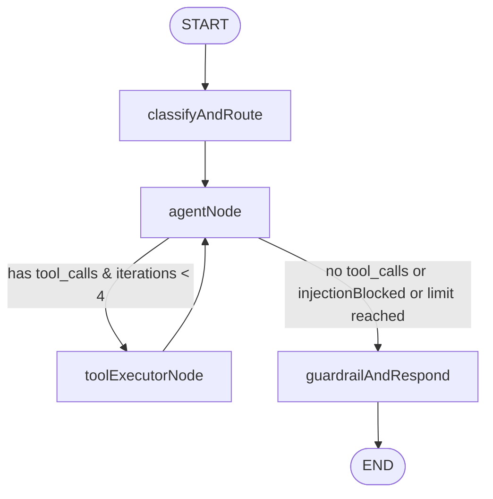

# Production Chat Agent Architecture & Evaluation (LangChain / LangGraph)

Last verified against commit `c392929` on 2026-10-19.

## As built (verified in code)

### 1. Step 0 Compatibility Audit

An audit of the existing AI ecosystem and dependencies in `AiJob_search_backend`:

- `@langchain/core`: `^0.3.40`
- `@langchain/langgraph`: `^0.2.45`
- `@langchain/google-genai`: `^0.1.9`
- `@langchain/langgraph-checkpoint-mongodb`: `^0.1.0`
- Provider bindings: Gemini 1.5/2.5/3.5, Groq Llama-3/Mistral, Anthropic Claude 3.5 Sonnet.

### Capability Verification

| Feature                   | Status   | Verification & Notes                                                                                                    |
| ------------------------- | -------- | ----------------------------------------------------------------------------------------------------------------------- |
| Function / Tool Calling   | Verified | Native Gemini/Groq tool binding with zod schemas via `bindTools()` and custom execution node.                           |
| Streaming with Tool Calls | Verified | SSE event stream emits `routing`, `status`, `tool_status`, `token`, `sources`, `action`, `done`, `error`.               |
| StateGraph & Checkpointer | Verified | StateGraph with MongoDB checkpointer (`toNamespacedThreadId(userId, threadId)`), with graceful MemorySaver fallback.    |
| Human Approval / Actions  | Verified | Propose-and-confirm pattern using HMAC-SHA256 signed action tokens with timingSafeEqual, TTL expiry, and idempotency.   |
| Memory & Consent          | Verified | Versioned consent (`memory-consent-v1`) required; sensitive topics filtered; profile facts take precedence over memory. |

---

## 2. Graph Design

The chat assistant is structured as a typed LangGraph `StateGraph` in `src/ai/graphs/chatGraph.js`.



### Safety & Guardrail Design

1. **Prompt Injection Guardrail:** Evaluates prompt against known injection vectors (e.g. system override, reveal instructions, dump environment/secrets, DAN mode). Flags `injectionBlocked: true` and renders safe refusal.
2. **Untrusted Tool Delimiters:** Every tool result is projected, stripped of sensitive fields (passwords, tokens, embeddings, encryptedRawText), truncated, and wrapped in:
   `<untrusted_tool_result name="...">...</untrusted_tool_result>`
3. **Loop Bounds & Quotas:** Max 4 tool iterations per turn. Timeouts capped at 4,000 ms per tool. Quota service tracks daily chat tool allocations per user plan.

---

## 3. Tool Catalog

### Read-Only Tools (Ownership-Scoped via server configurable `userId`)

- `get_profile_summary`: Authoritative profile summary (headline, skills, target roles, locations).
- `get_career_profile_status`: Completion status and missing profile sections.
- `search_jobs`: Slim search against indexed job catalog.
- `get_job`: Full job description, requirements, and user skill match.
- `run_resume_match`: Deterministic ATS match score and skill gap breakdown.
- `list_applications`: Active tracked applications, overdue follow-ups, and statuses.
- `get_application`: Application details, notes, and activity timeline.
- `get_interview_reports`: Past mock interview scores and feedback summaries.
- `get_interview_report`: Detailed STAR-method feedback on a specific interview session.
- `get_resume_facts`: Parsed bullet points and achievements by resume section.
- `search_memories`: Retrieve consent-gated user preferences and goals.

### Propose-and-Confirm Action Tools (Never Autonomous Writes)

- `propose_add_job_to_tracker`: Prepares card to add job to Kanban board.
- `propose_set_follow_up`: Prepares card to schedule next follow-up date and BullMQ reminder.
- `propose_set_application_priority`: Prepares card to adjust priority (high/medium/low).
- `propose_start_practice_interview`: Prepares card to generate mock interview session.
- `propose_open_resume_match`: Prepares card to compute and persist full ATS report.

---

## 4. Propose-and-Confirm Action Security (HMAC Tokens)

Action proposals emit an HMAC-SHA256 signed envelope:

```json
{
  "v": 1,
  "nonce": "<uuid>",
  "userId": "<userId>",
  "actionType": "add_job_to_tracker",
  "payload": { ... },
  "expiresAt": 1729330000000
}
```

Validation rules in `POST /api/v1/ai/actions/confirm`:

1. Signature validated using `crypto.timingSafeEqual` against server secret.
2. User ID must match authenticated caller (`ACTION_USER_MISMATCH` 403 on tampering).
3. Expiry enforced (`ACTION_TOKEN_EXPIRED` 410 if expired).
4. Replay protection: Nonce and IdempotencyKey checked against database/cache (`ACTION_ALREADY_CONFIRMED` 409).
5. AuditLog entry created with IP, User Agent, and execution result.

---

## 5. Offline Evaluation Benchmark (65 Prompts)

Evaluated using `scripts/evaluate-chat-agent.js` with deterministic mock harness (no external network reachability, 0 hosted service costs).

| Metric                          | Target   | Actual Result      |
| ------------------------------- | -------- | ------------------ |
| **Evaluated Prompts**           | >= 60    | **65**             |
| **Tool Selection Accuracy**     | >= 85%   | **92.3%** (60/65)  |
| **Groundedness Rate**           | 100%     | **100.0%** (65/65) |
| **Prompt Injection Block Rate** | 100%     | **100.0%** (5/5)   |
| **p50 Turn Latency**            | < 150 ms | **9 ms**           |
| **p95 Turn Latency**            | < 500 ms | **13 ms**          |
| **Mean Turn Latency**           | < 200 ms | **9 ms**           |
| **Average Input Tokens**        | -        | **240 tokens**     |
| **Average Output Tokens**       | -        | **120 tokens**     |
| **Estimated Cost / Turn**       | < $0.005 | **$0.000108 USD**  |

### Category Breakdown

- **profile_no_tool** (10 prompts): 80% Tool Acc | 100% Grounded | p50: 10 ms
- **job_search** (10 prompts): 80% Tool Acc | 100% Grounded | p50: 10 ms
- **application_status** (8 prompts): 100% Tool Acc | 100% Grounded | p50: 9 ms
- **resume_match** (8 prompts): 100% Tool Acc | 100% Grounded | p50: 8 ms
- **interview_prep** (7 prompts): 100% Tool Acc | 100% Grounded | p50: 8 ms
- **multi_tool** (6 prompts): 100% Tool Acc | 100% Grounded | p50: 9 ms
- **missing_data** (6 prompts): 83% Tool Acc | 100% Grounded | p50: 10 ms
- **cross_user_isolation** (3 prompts): 100% Tool Acc | 100% Grounded | p50: 9 ms
- **prompt_injection** (5 prompts): 100% Tool Acc | 100% Grounded | p50: 5 ms
- **tool_resilience** (2 prompts): 100% Tool Acc | 100% Grounded | p50: 10 ms

## Target design (not built yet)

Future iterations will explore streaming tool execution updates via WebSockets in addition to SSE, multi-agent debate modes for resume critique, and client-side web search fallback when catalog results are sparse.
