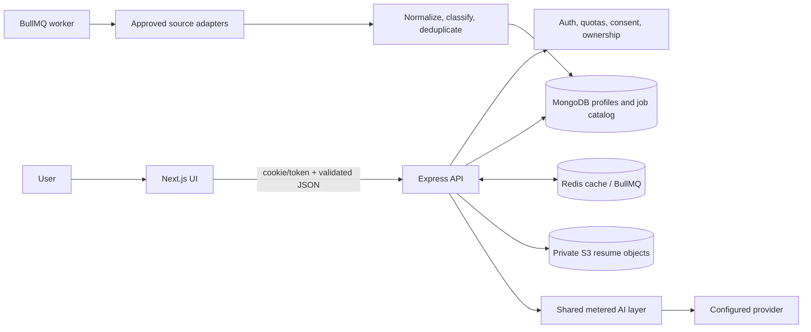

# IrowzScout independent reference architecture

**Status:** proposal grounded in the current separate frontend/backend repositories. No implementation changes are made by this document.

Last verified against commit `19a9e22951fe449e40690b88248c5db499eda809` for the backend references in this research set.

## As built (verified in code)

The current system uses a separate Next.js frontend and TypeScript/Express API, MongoDB/Mongoose, Redis/BullMQ, private S3 resume storage and shared AI services. See [backend catalog scaling](../architecture/job-catalog-scaling.md) and the frontend repository's `docs/ARCHITECTURE.md`.

## Target design (not built yet)

The architecture below is a target design to review; it describes no new service or application code as implemented.

## Existing system fit

The frontend is a Next.js 15 / React 19 App Router application. It uses a shared credentialed API client with request IDs, CSRF handling, timeout/abort, and Zod response parsing; Next middleware is only a session hint. The backend is Node.js 22 + TypeScript/Express with Clean Architecture, MongoDB/Mongoose, Redis/BullMQ, S3 resume storage, and a shared LLM/embedding boundary. The browser talks to the backend API; the worker shares backend data models. Keep the repositories separate and do not move business rules into Next.js.

## Bounded data flow

**Discovery:** UI filters → authenticated API → indexed Mongo catalog query → projected list DTO. This reads catalog only; user search must not synchronously start ingestion. **Ingestion:** repeatable worker task → enabled/approved source registry → one adapter → validate/normalize/hash → idempotent Mongo upsert → metrics and incremental match refresh. **Resume:** presigned upload → idempotent completion → extraction service → deterministic parsing → consent/data-policy-gated structured LLM only when needed → grounding/schema validation → encrypted user-owned facts.

## Domain model and indexes

Reuse `JobSource` for source policy, quotas, cursor, run/circuit/health; `Job` for normalized listing identity, location, salary, occupation, provenance, status and grouping; `JobDetail`/separated detail storage for long descriptions; existing profile/career profile/resume records for candidate facts; existing match records/cache for score version; existing application tracking and saved-search models. Do not add parallel copies of these concepts.

Current query shape and indexes are documented in `docs/architecture/job-catalog-scaling.md` and implemented in `JobModel.ts`: active/non-expired candidate queries by country/eligibility, remote mode, occupation/search tokens and recency, cursor ordering, and unique source identity. Use `explain("executionStats")` after schema/query changes; avoid redundant indexes because write amplification and RAM matter. Registry records must remain disabled until terms, license/permission, attribution, retention, quota, verification date, and approval are satisfied.

## API and reliability boundaries

Keep routes/controllers thin, use-case/application services for business policy, domain services for normalization/scoring, repositories for persistence, and infrastructure adapters for Mongo/S3/Redis/providers. Zod validate inbound and outbound contracts. Derive user IDs and permissions from server auth context; return 404 for cross-user object access. Mutations need idempotency where replayable. Queue tasks need stable idempotency keys, leases, bounded retry, dead-letter/observable terminal state, and cursor commits only after durable batch handling.

For source HTTP work, rate limit per source and host, set timeouts, cap response/body size, and retry only transient network/429/5xx within a small ceiling. A failed poll must not mark every listing closed. Ensure removal/expiry propagation respects source terms and removes derived vectors/cache as appropriate.

## Matching and model boundaries

Current shipped matching is deterministic lexical-v2 with structured profile/job factors and bounded candidate retrieval; the hot path is LLM/vector free. Keep retrieval → deterministic rank → evidence-based explanation separated. Optional embedding retrieval must be measured against labeled fixtures and never replace eligibility filters. LLM explanations cannot change the score or create missing facts.

Shared LLM service must apply catalog validation, per-feature data policy, consent, per-request and daily quota, cost ceiling, timeout, transient retry classification, usage ledger, and kill switch. Strict schema validation and evidence grounding precede persistence. Redact logs: no prompt, answer, resume text, signed URL, credential, or raw model payload.

## Security, privacy, and observability

Use private S3 objects with short-lived prefix-scoped presigned URLs; verify key ownership, size/type and completion idempotency. Encrypt sensitive resume text/facts; provide retention, export, correction, and delete paths. Treat provider outage and durable metering-store outage according to current fail-closed production decisions. Metrics should be aggregate and non-personal: source fetch/update/error/quota/latency and coverage; API p50/p95; DB examined/returned and index sizes; queue age/retry/dead-letter; LLM tokens/cost/outcome/cache hits.

## Capacity and monthly budget (indicative)

The repository's hosting note estimates **10k active users**, not jobs, at roughly $130–$280/month for a Lightsail baseline with separate/upsized processes and database/cache; 100 and 1,000 users are $40–$60 and $55–$95. Those are dated planning estimates, not quotes. Job count alone does not determine cost; query rate, index working set, description storage, refresh rates and user activity dominate. The same note has no validated 100k/1M-job hosting quote. A reasonable planning envelope—not a commitment—is:

|     Catalog size | Infrastructure planning range/month | Notes                                                                                                                                                  |
| ---------------: | ----------------------------------: | ------------------------------------------------------------------------------------------------------------------------------------------------------ |
|  10k active jobs |                            $50–$150 | One API/worker deployment, small Mongo/Redis tier, private object store. Includes hosting assumptions but not AI, email, egress spikes or backups.     |
| 100k active jobs |                           $150–$600 | Depends on Mongo storage/index RAM and ingestion throughput; benchmark before changing instance tiers.                                                 |
|   1M active jobs |                        $600–$2,500+ | Wide uncertainty: working-set/index size, replication, backup, IOPS and worker concurrency. Measure first; sharding/new managed search is not assumed. |

These catalog ranges are coarse incremental capacity scenarios anchored to existing 10k-user hosting estimates, not vendor quotes. They intentionally do not add paid infrastructure. Re-estimate with actual region/account pricing and measured BSON/index sizes before spend.

**LLM example:** deterministic matching cost is $0 per ranking request in provider spend. For optional uncached explanation, assume 2k input + 300 output tokens on Gemini 3.1 Flash-Lite at catalog rates: about $0.00095 per call; at 10k/100k/1M such calls monthly, ≈$9.50/$95/$950. A resume extraction assumption of 10k input + 1.5k output is about $0.00475 each; 1k/10k/100k new uploads ≈$4.75/$47.50/$475. Do not send personal data to unpaid tiers. Actual routing, cache hits, provider tiers, retries, currency/tax and current prices change these figures. [Official Gemini pricing](https://ai.google.dev/gemini-api/docs/pricing), accessed 2026-10-20.

## Scale triggers (measure before scaling)

1. Add no infrastructure until API p95, Mongo explain, queue age, worker CPU/memory, DB storage/index size and source quotas show a sustained bottleneck.
2. First tune projections, compound indexes, query cap, batch size, cache TTL, and per-source cadence.
3. Split API and worker processes on existing hosting only when workload isolation or CPU warrants it.
4. Upgrade Mongo/Redis capacity within the existing service model before proposing a new datastore or search service.
5. Consider sharding or dedicated search only after explain/benchmark data shows a single Mongo deployment cannot meet a stated SLO; produce migration, ops, and cost plan for approval.

## Verification

Architecture statements were checked against the frontend architecture/API client docs and backend source/docs, including the current job/source models, ingestion engine and matching service. Live deployment sizing and service status are not verified. Cost bands are explicitly planning scenarios rather than provider quotes. `npm run docs:check` validates local documentation structure.
