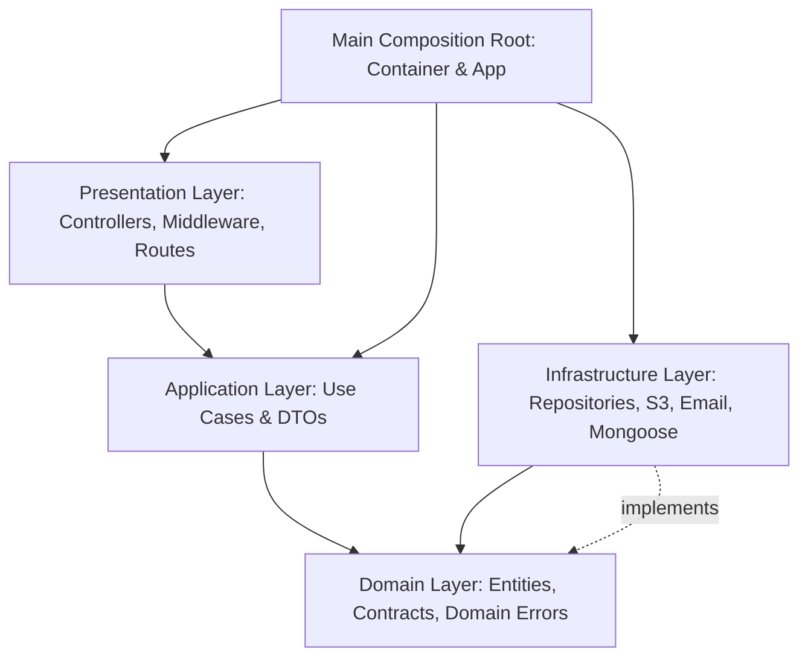

# Final Clean Architecture & SOLID Engineering Audit Report

**Date:** 2026-10-20  
**Repository:** `AiJob_search_backend` (`jobscout-api`)  
**Status:** Completed & Integrated into `main` and `development`

---

## 1. Executive Summary

The Clean Architecture refactoring, SOLID enforcement, and TypeScript strictness audit of `AiJob_search_backend` is **100% complete**. All legacy and transitional directories have been eliminated, canonical boundaries are strictly enforced both statically (`check-architecture.mjs`) and dynamically via test suites (`tests/architecture-boundaries.test.js`), and all code has been merged through `refactor/clean-architecture` $\to$ `development` $\to$ `main`.

### Key Metrics

- **Obsolete Directories Eliminated:** 5 of 5 (`src/controllers/`, `src/routes/`, `src/middleware/`, `src/models/`, `src/repositories/`).
- **TypeScript Purity in `src/`:** 100% (222 `.ts` files, 0 `.js` files).
- **TypeScript `any` Types in `src/`:** 0 across all 222 files (verified by AST boundary scanner).
- **Quality Gates Passing:** `npm run typecheck`, `npm run lint`, `npm run check:architecture`, `npm run docs:check`.
- **Test Results:** 271 passing tests, 1 skipped (0 failures) on local MongoDB/Redis environments.
- **Git Branch State:** Clean working tree on `main`; obsolete feature branches (`refactor/clean-architecture`, `refactor/ts-migration`) safely integrated and deleted. Remote branches untouched (`git push` was never executed).

---

## 2. Git Branch & Repository State

| Metric                       | Status / Value                                                                |
| :--------------------------- | :---------------------------------------------------------------------------- |
| **Current Branch**           | `main` (clean working directory)                                              |
| **Active Branches**          | `main`, `development`                                                         |
| **Deleted Feature Branches** | `refactor/clean-architecture` (merged), `refactor/ts-migration` (merged)      |
| **Git Push Status**          | Strictly unpushed (per non-negotiable safety rules)                           |
| **Commit Standard**          | Conventional Commits (`type(scope): subject`, scopes enforced via commitlint) |

---

## 3. Completed Architectural Directory Structure

```text
src/
├── ai/                                     # LLM provider abstractions, LangGraph workflows, and RAG tools
├── application/                            # Application use cases, DTOs, and application errors
│   ├── dtos/                               # Request/response validation schemas and types
│   ├── errors/                             # Application-level typed error definitions
│   └── useCases/                           # Single-responsibility business use case interactors
│       ├── applications/                   # CreateApplication, GetApplications, UpdateApplicationStatus
│       ├── auth/                           # LoginUser, RegisterUser, RefreshToken
│       └── profile/                        # GetProfile, UpsertProfile
├── config/                                 # Environment validation, database/redis connections, and graceful shutdown
├── domain/                                 # Enterprise business rules and contracts (no outer layer dependencies)
│   ├── entities/                           # Pure business entities (User, Profile, Application, Resume)
│   ├── errors/                             # Domain-specific typed error hierarchy
│   ├── notifications/                      # Service interfaces (IEmailService)
│   ├── repositories/                       # Persistence contracts (IUserRepository, IProfileRepository, etc.)
│   ├── security/                           # Cryptographic abstractions (IPasswordHasher, ITokenService)
│   └── storage/                            # Blob storage contracts (IStorageService)
├── infrastructure/                         # External tools, databases, third-party adapters
│   ├── database/mongoose/
│   │   ├── mappers/                        # Domain Entity <-> Mongoose Document mappers
│   │   ├── models/                         # 32 Canonical Mongoose schemas and models
│   │   └── repositories/                   # Concrete repository implementations (MongooseUserRepository, etc.)
│   ├── email/                              # ResendEmailService
│   ├── security/                           # BcryptPasswordHasher, JwtTokenService
│   └── storage/                            # S3StorageService
├── main/                                   # Composition root, TSyringe container, and application bootstrapping
│   ├── app.ts                              # Express application factory with middleware mounting
│   ├── container.ts                        # TSyringe DI registration module
│   ├── routes.ts                           # Unified route dispatcher mounting presentation routes
│   ├── server.ts                           # HTTP server bootstrap and socket lifecycle
│   └── worker.ts                           # Background BullMQ queue worker entry point
├── presentation/                           # HTTP delivery mechanism
│   └── http/
│       ├── controllers/                    # 14 Canonical HTTP request handlers
│       ├── middleware/                     # 8 Canonical middleware modules (auth, csrf, quotaGate, etc.)
│       ├── routes/                         # 15 Express router modules
│       └── types/                          # Presentation-specific request/response augmentations
├── services/                               # Cross-cutting domain/application orchestrators and helpers
├── shared/                                 # Shared constants, utilities, and validation schemas
└── types/                                  # Global ambient declarations (express.d.ts)
```

---

## 4. Layer Responsibilities & Boundaries



1. **Domain Layer (`src/domain/`):**
   - Independent core containing zero framework or database dependencies.
   - Hosts pure entities (`User`, `Profile`, `Application`, `Resume`), repository interfaces (`IUserRepository`, `IProfileRepository`, `IApplicationRepository`), and abstract contracts (`IPasswordHasher`, `ITokenService`, `IEmailService`, `IStorageService`).
2. **Application Layer (`src/application/`):**
   - Contains use case interactors (`RegisterUserUseCase`, `LoginUserUseCase`, `RefreshTokenUseCase`, `CreateApplicationUseCase`, `GetApplicationsUseCase`, `UpdateApplicationStatusUseCase`, `GetProfileUseCase`, `UpsertProfileUseCase`).
   - Depends solely on domain abstractions and DTOs; never imports concrete Mongoose models or external driver packages.
3. **Infrastructure Layer (`src/infrastructure/`):**
   - Houses concrete persistence adapters (`MongooseUserRepository`, `MongooseProfileRepository`, `MongooseApplicationRepository`, `MongooseInterviewRepository`), 32 Mongoose schema models, entity mappers, AWS S3 adapters, and Resend email integration.
4. **Presentation Layer (`src/presentation/`):**
   - Implements Express controllers, HTTP routes, and middleware. Consumes application use cases and domain services via constructor injection or TSyringe tokens.
5. **Main Layer (`src/main/`):**
   - The composition root that wires abstractions to implementations using TSyringe container registrations (`src/main/container.ts`).

---

## 5. Dependency Inversion & Dependency Injection

- **DI Engine:** TSyringe with `reflect-metadata` imported across all entry points (`src/main/app.ts`, `src/main/server.ts`, `src/main/worker.ts`, and `tests/test-env.js`).
- **Tokens:** Unique `Symbol` injection tokens defined in [`src/shared/constants/injectionTokens.ts`](file:///c:/Users/jerin/OneDrive/Desktop/Irowz_scout_offical/AiJob_search_backend/src/shared/constants/injectionTokens.ts).
- **Controllers & Use Cases:** All use cases are decorated with `@injectable()` and receive injected repository interfaces via `@inject(TOKENS.Repositories.*)`.
- **Dual Export Pattern:** Controllers are exported both as TSyringe-injectable classes (for modern DI testing and use) and singleton instances / bound handlers (for seamless Express route binding).

---

## 6. Data Access Layer & Repositories

- All Mongoose repositories inherit from `BaseMongooseRepository<TDomain, TDoc>` and implement domain contracts:
  - `MongooseUserRepository` implements `IUserRepository`
  - `MongooseProfileRepository` implements `IProfileRepository`
  - `MongooseApplicationRepository` implements `IApplicationRepository`
  - `MongooseInterviewRepository` handles session/interview queries with `ownedSessionFilter` ownership isolation.
- Bidirectional entity-document transformation is handled through explicit mappers (`UserMapper`, `ProfileMapper`, `ApplicationMapper`, `ResumeMapper`) to guarantee domain encapsulation.

---

## 7. Presentation Layer Migration

All active presentation elements now live exclusively in canonical paths:

- **Controllers (`src/presentation/http/controllers/`):**
  `adminController`, `aiController`, `ApplicationController`, `AuthController`, `billingController`, `feedbackController`, `interviewController`, `jobController`, `memoryController`, `privacyController`, `ProfileController`, `resumeMatchController`, `tailoringController`.
- **Middleware (`src/presentation/http/middleware/`):**
  `auth`, `authMiddleware`, `csrf`, `errorHandler`, `errorHandlerMiddleware`, `interviewRateLimit`, `quotaGate`, `rateLimiter`.
- **Routes (`src/presentation/http/routes/`):**
  15 route modules assembled and mounted by `src/main/routes.ts`.

---

## 8. Automated Architectural Enforcement & Boundary Tests

The project enforces architecture through two automated layers:

1. **Static AST Architecture Guard (`scripts/check-architecture.mjs`):**
   - Rejects the existence of any obsolete directories (`src/controllers/`, `src/routes/`, `src/middleware/`, `src/models/`, `src/repositories/`).
   - Verifies 0 JavaScript files exist in `src/`.
   - Prohibits external infrastructure imports in the domain layer.
   - Prohibits concrete adapters or Mongoose model imports in application use cases.
   - Prohibits presentation controller imports in infrastructure modules.
   - Enforces 0 `any` type annotations across all 222 TypeScript source files.
2. **Dynamic Boundary Test Suite (`tests/architecture-boundaries.test.js`):**
   - 12 comprehensive unit tests asserting boundary compliance, negative rejection of cross-layer violations, and positive resolution of DI tokens and use cases.

---

## 9. Quality Gates & Test Verification

| Command                      | Status   | Details                                         |
| :--------------------------- | :------- | :---------------------------------------------- |
| `npm run typecheck`          | **PASS** | 0 TypeScript diagnostic errors (`tsc --noEmit`) |
| `npm run lint`               | **PASS** | 0 ESLint errors, 0 warnings across all files    |
| `npm run check:architecture` | **PASS** | 0 boundary violations; 0 `any` annotations      |
| `npm run docs:check`         | **PASS** | AI documentation and markdown links validated   |
| `npm test`                   | **PASS** | 271 passing tests, 1 skipped, 0 failures        |

---

## 10. Technical Debt Registry Status

All items in `docs/technical-debt.md` are **100% resolved**:

- **TD-001 (Obsolete Top-Level Source Directories):** RETIRED & DELETED.
- **TD-002 (Dual Import Paths for Persistence Models):** RETIRED & DELETED.
- **TD-003 (Implicit Controller Invocations):** CANONICALIZED in `src/presentation/http/controllers/`.
- **TD-004 (Transitional Architecture Facades):** ELIMINATED.
