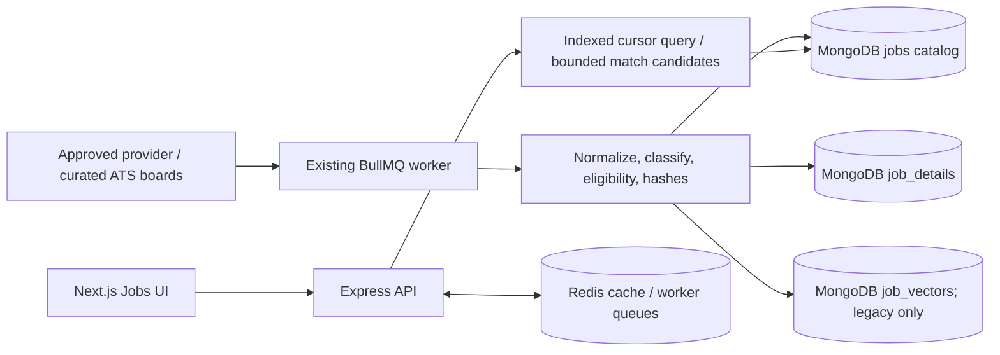

# Job catalog scaling architecture

## Current deployment shape

The backend is an Express API, MongoDB catalog/profile store, Redis cache/queue, and the existing BullMQ worker. The frontend is a separate Next.js application. Job discovery reads the persisted Mongo catalog; worker jobs ingest sources on their schedules. The API and worker share the same backend repository and data models. The current worker and database sizing is deployment-dependent and not inferred here.

## Read/write paths

No user request starts ingestion. The list route uses indexed cursor pagination and projects out descriptions/vectors; the detail route loads the separate detail record with legacy-field fallback. Matching stays deterministic, bounded, and embedding/LLM-free in the hot path.

## Scaling plan

- **100k jobs:** keep one MongoDB deployment, the existing worker, bounded unordered batches and a small query/index set. Measure index size and query plans before adding indexes.
- **500k jobs:** tune batch size and source concurrency from benchmark and worker metrics; separate detail reads from list reads; consider a second worker process only if the existing queue and host have CPU/memory headroom. No new infrastructure is assumed.
- **1M+ jobs:** validate the actual hot index working set against RAM and storage, query p95 and write amplification. If one Mongo deployment/worker no longer meets SLOs, propose a measured vertical scale-up or sharding plan with costs; do not enable sharding, Atlas Search, or a new service without separate approval.

The benchmark is a local synthetic guide, not a sizing guarantee. SLOs and deployment prices are not configured in this repository; capacity and monthly cost remain Unverified until the benchmark and hosting plan are known.
