# Graphify Dependency Analysis & Cleanup Verification

Generated: 2026-10-19  
Repository: `AiJob_search_backend`  
Knowledge Graph: `graphify-out/graph.json` (2,818 nodes, 6,187 edges, 194 communities)

---

## 1. Executive Summary

A comprehensive dependency analysis using Graphify (`graphify query`, `graphify path`, `graphify explain`) and static import analysis was performed across all 159 JavaScript files in `src/`.

### Key Graph Findings

1. **Active Interconnections:**
   Every legacy JavaScript module in `src/models/`, `src/repositories/`, `src/services/`, `src/controllers/`, and `src/routes/` is deeply linked to active application features (jobs matching, AI chat graph, resume parsing, interview engine, billing, and GDPR exports).
2. **Dual-Stack Coexistence:**
   The newly introduced TypeScript Clean Architecture layer (`src/domain/`, `src/application/`, `src/infrastructure/`, `src/presentation/`, `src/main/`) compiles cleanly to `dist/`, but `src/app.js` and `src/server.js` continue to serve legacy HTTP routes.
3. **Premature Deletion Hazard:**
   Directly deleting legacy JavaScript files (e.g., `src/controllers/authController.js` or `src/models/User.js`) causes immediate cascading breakage in `src/routes/`, `src/services/`, and existing integration tests.
4. **Resolution Strategy:**
   - Unify the application entry points (`src/main/app.ts`, `src/main/server.ts`, `src/main/worker.ts`).
   - Re-export or wire migrated TypeScript routes into the primary Express router.
   - Maintain behavioral equivalence across DTOs, mappers, entities, and use cases.
   - Delete obsolete duplicate files ONLY when their incoming edge count in `graph.json` is reduced to 0.

---

## 2. Dependency Subgraphs for Core Domains

### 2.1 Authentication Subgraph

```mermaid
flowchart TD
  subgraph LegacyFlow ["Legacy ESM Route Flow"]
    AppJS["src/app.js"] --> AuthRoute["src/routes/auth.js"]
    AuthRoute --> AuthCtrl["src/controllers/authController.js"]
    AuthCtrl --> AuthSvc["src/services/authService.js"]
    AuthSvc --> UserRepo["src/repositories/userRepository.js"]
    UserRepo --> UserModel["src/models/User.js"]
  end

  subgraph CleanTSFlow ["Migrated Clean Architecture Flow"]
    MainApp["src/main/app.ts"] --> ApiRouter["src/presentation/http/routes/index.ts"]
    ApiRouter --> TSAuthRoute["src/presentation/http/routes/authRoutes.ts"]
    TSAuthRoute --> TSAuthCtrl["src/presentation/http/controllers/AuthController.ts"]
    TSAuthCtrl --> RegUseCase["RegisterUserUseCase.ts"]
    TSAuthCtrl --> LoginUseCase["LoginUserUseCase.ts"]
    RegUseCase --> IUserRepo["IUserRepository.ts (Contract)"]
    IUserRepo -.->|implements| MongoUserRepo["MongooseUserRepository.ts"]
    MongoUserRepo --> TSUserModel["UserModel.ts (Mongoose Schema)"]
    MongoUserRepo --> UserMapper["UserMapper.ts"]
  end
```

### 2.2 Application Tracker Subgraph

```mermaid
flowchart TD
  subgraph LegacyFlow ["Legacy Applications Flow"]
    AppJS2["src/app.js"] --> AppRoute["src/routes/applications.js"]
    AppRoute --> AppCtrl["src/controllers/applicationController.js"]
    AppCtrl --> AppRepo["src/repositories/applicationRepository.js"]
    AppRepo --> AppModel["src/models/Application.js"]
  end

  subgraph CleanTSFlow ["Migrated Clean Architecture Flow"]
    MainApp2["src/main/app.ts"] --> ApiRouter2["src/presentation/http/routes/index.ts"]
    ApiRouter2 --> TSAppRoute["src/presentation/http/routes/applicationRoutes.ts"]
    TSAppRoute --> TSAppCtrl["src/presentation/http/controllers/ApplicationController.ts"]
    TSAppCtrl --> GetAppsUC["GetApplicationsUseCase.ts"]
    TSAppCtrl --> CreateAppUC["CreateApplicationUseCase.ts"]
    TSAppCtrl --> UpdateAppUC["UpdateApplicationStatusUseCase.ts"]
    CreateAppUC --> IAppRepo["IApplicationRepository.ts"]
    IAppRepo -.->|implements| MongoAppRepo["MongooseApplicationRepository.ts"]
    MongoAppRepo --> TSAppModel["ApplicationModel.ts"]
    MongoAppRepo --> AppMapper["ApplicationMapper.ts"]
  end
```

### 2.3 Profile & Resume Subgraph

```mermaid
flowchart TD
  subgraph LegacyFlow ["Legacy Profile Flow"]
    AppJS3["src/app.js"] --> ProfRoute["src/routes/profile.js"]
    ProfRoute --> ProfCtrl["src/controllers/profileController.js"]
    ProfCtrl --> ProfRepo["src/repositories/profileRepository.js"]
    ProfRepo --> ProfModel["src/models/Profile.js"]
    ProfRepo --> ResumeModel["src/models/Resume.js"]
  end

  subgraph CleanTSFlow ["Migrated Clean Architecture Flow"]
    MainApp3["src/main/app.ts"] --> ApiRouter3["src/presentation/http/routes/index.ts"]
    ApiRouter3 --> TSProfRoute["src/presentation/http/routes/profileRoutes.ts"]
    TSProfRoute --> TSProfCtrl["src/presentation/http/controllers/ProfileController.ts"]
    TSProfCtrl --> GetProfUC["GetProfileUseCase.ts"]
    TSProfCtrl --> UpsertProfUC["UpsertProfileUseCase.ts"]
    UpsertProfUC --> IProfRepo["IProfileRepository.ts"]
    IProfRepo -.->|implements| MongoProfRepo["MongooseProfileRepository.ts"]
    MongoProfRepo --> TSProfModel["ProfileModel.ts"]
    MongoProfRepo --> TSResumeModel["ResumeModel.ts"]
    MongoProfRepo --> ProfMapper["ProfileMapper.ts"]
  end
```

---

## 3. Detailed Callers & References for Migrated Targets

| Target Domain         | Legacy JS File                              |     Direct Callers in `src/`     | Direct Callers in `tests/` | TS Clean Architecture Replacement                                                    | Safety Action                                   |
| :-------------------- | :------------------------------------------ | :------------------------------: | :------------------------: | :----------------------------------------------------------------------------------- | :---------------------------------------------- |
| **Auth**              | `src/controllers/authController.js`         |     1 (`src/routes/auth.js`)     |             0              | `src/presentation/http/controllers/AuthController.ts`                                | Retain until router unified                     |
| **Auth**              | `src/routes/auth.js`                        |     14 (`src/app.js`, tests)     |             0              | `src/presentation/http/routes/authRoutes.ts`                                         | Wire to clean router                            |
| **Applications**      | `src/controllers/applicationController.js`  | 1 (`src/routes/applications.js`) |             2              | `src/presentation/http/controllers/ApplicationController.ts`                         | Retain until router unified                     |
| **Applications**      | `src/routes/applications.js`                |         2 (`src/app.js`)         |             0              | `src/presentation/http/routes/applicationRoutes.ts`                                  | Wire to clean router                            |
| **Profile**           | `src/controllers/profileController.js`      |   1 (`src/routes/profile.js`)    |             6              | `src/presentation/http/controllers/ProfileController.ts`                             | Retain until router unified                     |
| **Profile**           | `src/routes/profile.js`                     |         2 (`src/app.js`)         |             0              | `src/presentation/http/routes/profileRoutes.ts`                                      | Wire to clean router                            |
| **User Repo**         | `src/repositories/userRepository.js`        |  13 (services, routes, worker)   |             2              | `src/infrastructure/database/mongoose/repositories/MongooseUserRepository.ts`        | Keep compatibility adapter                      |
| **Profile Repo**      | `src/repositories/profileRepository.js`     |   10 (services, match, worker)   |             3              | `src/infrastructure/database/mongoose/repositories/MongooseProfileRepository.ts`     | Keep compatibility adapter                      |
| **Application Repo**  | `src/repositories/applicationRepository.js` |       7 (services, worker)       |             2              | `src/infrastructure/database/mongoose/repositories/MongooseApplicationRepository.ts` | Keep compatibility adapter                      |
| **User Model**        | `src/models/User.js`                        |   10 (services, repos, worker)   |             7              | `src/infrastructure/database/mongoose/models/UserModel.ts`                           | Shared schema compatibility                     |
| **Profile Model**     | `src/models/Profile.js`                     |   12 (services, repos, worker)   |             7              | `src/infrastructure/database/mongoose/models/ProfileModel.ts`                        | Shared schema compatibility                     |
| **Application Model** | `src/models/Application.js`                 |   8 (services, repos, worker)    |             4              | `src/infrastructure/database/mongoose/models/ApplicationModel.ts`                    | Shared schema compatibility                     |
| **Resume Model**      | `src/models/Resume.js`                      |   9 (services, repos, worker)    |             3              | `src/infrastructure/database/mongoose/models/ResumeModel.ts`                         | Shared schema compatibility                     |
| **Server**            | `src/server.js`                             |                0                 |             0              | `src/main/server.ts`                                                                 | Migrate startup logic & update package scripts  |
| **Worker**            | `src/worker.js`                             |                0                 |             0              | `src/main/worker.ts`                                                                 | Migrate worker queues & update package scripts  |
| **App**               | `src/app.js`                                |                2                 |             1              | `src/main/app.ts`                                                                    | Mount complete router and re-export `createApp` |

---

## 4. Safety Protocol for Clean Architecture Enforcement

1. **Step 1: Complete `src/main/app.ts` Router Wiring**  
   Ensure `src/main/app.ts` registers all 14 routes:
   - Clean Architecture routes (`/api/v1/auth`, `/api/v1/applications`, `/api/v1/profile`).
   - Feature routes (`jobs`, `ai`, `memories`, `interview`, `billing`, `admin`, `privacy`, `resumeMatch`, `feedback`, `tailor`, `health`).
   - Raw body handler for `/api/v1/billing/razorpay-webhook`.
   - Global 404 handler and `errorHandlerMiddleware`.

2. **Step 2: Migrate Worker Entry Point to `src/main/worker.ts`**  
   Implement strongly-typed `src/main/worker.ts` preserving BullMQ job ingestion, repeat schedules, heartbeat, FX rates, and graceful teardown.

3. **Step 3: Update `src/app.js` to Delegate to `src/main/app.ts`**  
   Ensure that any test or script importing `src/app.js` automatically gets the Clean Architecture application without duplicating routing code.

4. **Step 4: Update `src/server.js` to Delegate to `src/main/server.ts`**  
   Unify server bootstrap so both direct `node src/server.js` and `npm run start` execute the TypeScript server.

5. **Step 5: Incremental Verification & Test Coverage**  
   Run `npm run build`, `npm test`, `npm run lint`, and `npm run docs:check` after every atomic change.
