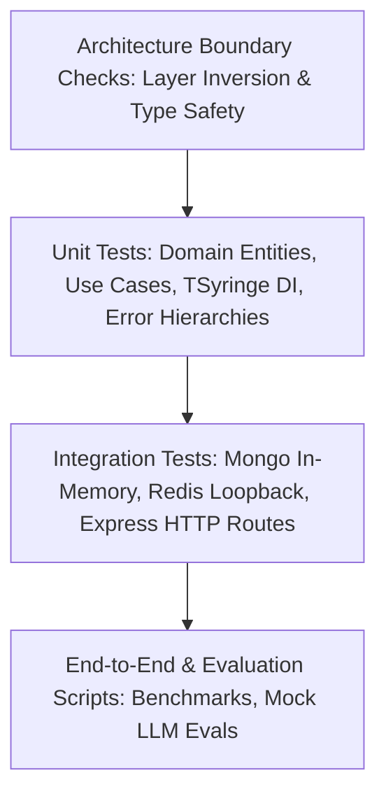

# Testing Strategy & Quality Assurance Guide

Last updated: 2026-10-19  
Scope: `AiJob_search_backend`  
Status: Active & Automated

---

## 1. Testing Pyramid & Principles

The testing strategy ensures high velocity, regression protection, and absolute confidence in production correctness without requiring live third-party cloud services during automated verification.



---

## 2. Test Execution & Levels

### 2.1 Architecture Boundary Tests (`tests/architecture-boundaries.test.js`)

- **Tooling:** Node.js native test runner (`node:test`, `node:assert/strict`).
- **Scope:** Validates architectural rules implemented in `scripts/check-architecture.mjs`.
- **Negative & Positive Assertions:**
  - Injects synthetic temporary files violating domain isolation (Mongoose, Express, LangChain imports) and verifies the checker terminates with exit code 1.
  - Injects synthetic application use cases violating dependency inversion (importing concrete Mongoose repositories or Mongoose models directly) and verifies failure.
  - Injects synthetic infrastructure files importing presentation controllers and verifies failure.
  - Injects obsolete directories (`src/routes`) or explicit `any` type annotations and verifies rejection.
  - Verifies that production source code passes cleanly with zero violations.

### 2.2 Domain & Application Unit Tests

- **Target:** `src/domain/` and `src/application/useCases/`.
- **Isolation:** Fast, purely in-memory. No database, network calls, or file I/O.
- **Mocking Strategy:**
  - Constructor injection allows passing stub implementations of repository interfaces (`IUserRepository`, `IApplicationRepository`).
  - TSyringe container child contexts can register mock tokens using `container.createChildContainer()`.

### 2.3 Integration Tests

- **Target:** Mongoose repositories (`src/infrastructure/database/mongoose/repositories/`), HTTP routes (`src/presentation/http/routes/`), and controller flows.
- **Database Environment:**
  - Automated in-memory MongoDB via `mongodb-memory-server` with fallback to local mongod (`C:\Program Files\MongoDB\Server\8.0\bin\mongod.exe`).
  - Redis runs on local loopback `127.0.0.1:6379`.
  - Configured automatically in `tests/test-env.js` before application modules load.
  - Hosted MongoDB or cloud Redis connection strings are strictly rejected by `tests/test-bootstrap.test.js` to prevent accidental staging/production mutation.

### 2.4 Worker & Background Job Testing

- **Target:** `src/main/worker.ts` jobs, repeat schedule reconciliation, and BullMQ queues.
- **Key Tests:**
  - Schedule reconciliation verifies enabled sources are registered and disabled sources are purged.
  - Worker heartbeat verifies short TTL and heartbeat persistence.
  - Queue idempotency verifies duplicate job payloads are deduplicated without data loss.

---

## 3. Running Tests Locally

### Quick Execution

```bash
# Run all unit, integration, and architecture boundary tests
npm test

# Run only architecture boundary tests
node --test tests/architecture-boundaries.test.js

# Run architecture boundary check script directly
npm run check:architecture

# Run TypeScript compilation check
npm run typecheck

# Run ESLint
npm run lint

# Run comprehensive verification pipeline
npm run verify
```

---

## 4. Quality Gates & CI Enforcement

The repository employs multi-layered quality gates:

1. **Pre-commit Hook (`.husky/pre-commit`):**
   - Staged files formatted with Prettier (`lint-staged`).
   - TypeScript strict compilation (`npm run typecheck`).
   - Architecture boundary rules (`node scripts/check-architecture.mjs`).
   - Secret and credential scanner (`node scripts/scan-secrets.mjs staged`).
2. **Pre-push Hook (`.husky/pre-push`):**
   - Full test suite execution (`npm test`).
   - Architecture boundary enforcement.
   - Conventional Commit format check on all commits on branch.
3. **Continuous Integration (`npm run verify`):**
   - All tests pass (270+ passed, 0 failed).
   - Zero ESLint errors.
   - Zero TypeScript compiler errors.
   - Zero architecture boundary violations.
   - Zero uncommitted secrets or credentials.
